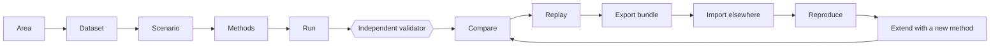
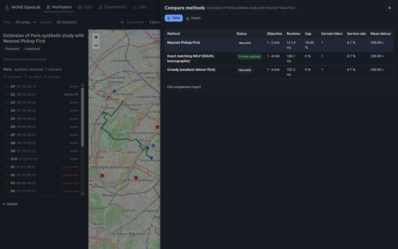
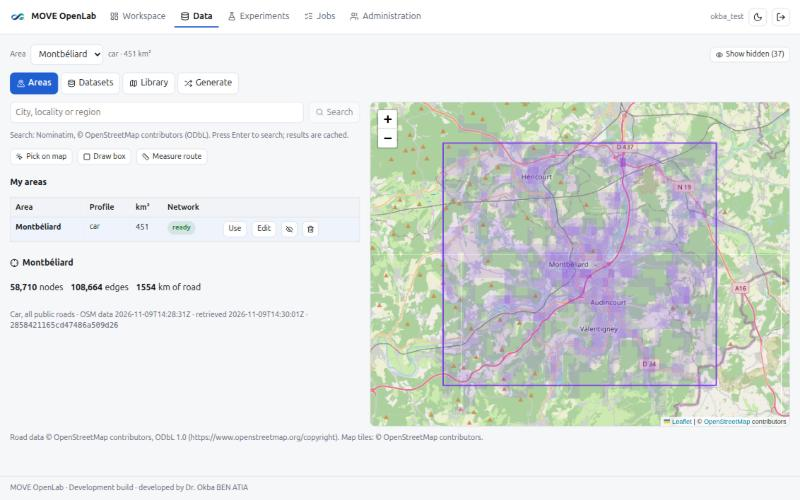
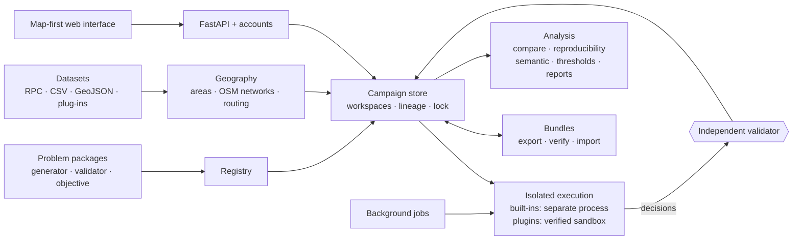

<!-- LOGO: reserved for the authentic MOVE OpenLab logo (docs/assets/logo.*), to be supplied by the maintainer. -->

# MOVE OpenLab

**A reproducible experimentation framework for optimization research.**

Run optimization methods on real or synthetic scenarios, validate every solution independently, compare methods
fairly, and hand the whole experiment to a colleague who can reproduce it on their own machine and extend it with
their own algorithm.

> **Status: pre-release.** Functional and tested locally; licence, logo and demonstration video are being prepared
> for the first public release.

<!-- VIDEO: reserved for the 60–75 s demonstration video of the released version, to be supplied by the maintainer. -->


*The workspace with the built-in demonstration: Area · Dataset · Scenario on the left, routes of the exact method on
the map, results and comparability on the right. Map tiles © OpenStreetMap contributors.*

## Why MOVE OpenLab

Comparing optimization methods fairly is hard: results depend on data, settings, solver versions and hardware, and
experiments rarely travel between labs intact. MOVE OpenLab makes the experiment the unit of work: frozen scenarios,
an independent validator, locked results with checksums, a portable bundle, and explicit rules saying when two
results may be compared.

## Core features

| | |
|---|---|
| Map-first workspace | Choose an area, dataset and experiment; see participants and routes on the map; run, compare, replay, export — on one screen |
| Built-in demonstration | Two experiments on Paris (open carpooling data, OpenStreetMap routing) open on first sign-in |
| Methods | Exact MILP (HiGHS) and heuristics built in; your own methods as sandboxed plugins |
| Independent validation | Every solution re-checked by the problem's validator; self-reported values are only compared |
| Comparison | Concise table, charts of any supported metric (CSV, SVG, PNG export), what each result proves |
| Reproducibility | Verified bundles without code; re-execution compared cell by cell; lineage of every experiment |
| Semantic comparability | *Directly comparable*, *comparable with conditions* or *not comparable*, with the reasons |
| Replay | Vehicles, pickups, drop-offs, served and unserved riders over time |
| Geography and data | Any area OpenStreetMap covers; RPC open data (France), CSV, GeoJSON, synthetic demand, provider plug-ins |
| Operations | Background jobs with progress and cancellation; accounts, administration, audit log |

## Pipeline



## Import → Reproduce → Extend

1. **Import** — a colleague's bundle is verified completely (every hash, checksum, fingerprint and the lineage)
   before anything is stored; it never contains code. The experiment opens marked *Imported from …*.
2. **Reproduce** — *Run* with the same methods re-executes it on your installation; the experiment reads
   *Reproduced ✓* when every result is identical.
3. **Extend** — tick your own method and *Run*: it runs on exactly the same instances and appears in *Compare* next to
   the original methods; the comparability badge tells you which claims hold.



## Geographic and data flexibility

- **Any area.** Search a city or region, click the map or draw a box, resize it, save it, load its road network
  (profiles: all roads, main roads, peak-hour speeds) and switch between areas. Nothing is tied to one city.
- **Any trip data.** RPC carpooling open data for areas in France; CSV files with explicit column mapping; GeoJSON;
  seeded synthetic demand; a provider interface for other sources. Invalid rows are counted with reasons.
- **Lists follow the area.** Datasets, scenarios and experiments are filtered by the selected area, with *All areas*
  available; the workspace always states *Area · Dataset · Scenario*.

Details: [docs/DATASETS.md](docs/DATASETS.md).

| Areas and routing (València) | Threshold study | Route playback |
|---|---|---|
|  |  |  |

## Add your own algorithm

```bash
move-openlab method new my_method --problem public-ride-matching --dir plugins
```

```bash
move-openlab method check plugins/my_method --bundle experiment.zip
```

Implement `solve(instance, config)` in the generated `plugin.py`; `method check` verifies the metadata, runs a
self-test in the sandbox, runs your method on every instance of the imported experiment and compares it with the
experiment's methods, with clear errors at each step. Register it in the web interface, tick it in the workspace and
press *Run*. The experiment keeps ownership of the scenario, objective, validator and metrics. Guide:
[docs/EXTENDING.md](docs/EXTENDING.md); result and run-record schemas: [`schemas/`](schemas/).

## Quick start

Requirements: Python ≥ 3.11, Node.js ≥ 20; for sandboxed plugins, Linux with bubblewrap.

```bash
python -m venv .venv && .venv/bin/pip install -e ".[dev]"
```

```bash
cd frontend && npm ci && npm run build && cd ..
```

```bash
.venv/bin/move-openlab users add alice --display-name "Alice" --role admin
```

```bash
.venv/bin/move-openlab serve
```

Open http://127.0.0.1:8765, sign in with the temporary password printed by `users add` and choose your own. The
demonstration opens automatically; the optional Quick Tour explains the screen in eight steps.

## Demo

*Public Mobility Demo — Baseline* and *Public Mobility Demo — Controlled Variant*: three scenarios of 20 drivers and
30 riders resampled with fixed seeds from RPC open data (release 2026-08) inside Paris, travel times on the
OpenStreetMap road network, an exact MILP and a greedy heuristic. The variant lowers the detour limit without
removing any compatible pair, so its results are directly comparable with the baseline; a binding variant created
from *Advanced* shows *Not comparable*, and a re-execution on another installation shows *comparable with conditions*
for runtimes. Provenance and licences:
[src/move_openlab/demo/README.md](src/move_openlab/demo/README.md).

## Architecture



Details: [docs/ARCHITECTURE.md](docs/ARCHITECTURE.md). A fully synthetic benchmark (capacitated assignment, certified
against brute force and an independent min-cost-flow oracle) is included for methodological tests.

## Documentation

| Document | Content |
|---|---|
| [docs/ARCHITECTURE.md](docs/ARCHITECTURE.md) | Components, web interface, data model, pipeline |
| [docs/DATASETS.md](docs/DATASETS.md) | Areas, road networks, datasets, external services and their rules |
| [docs/REPRODUCIBILITY.md](docs/REPRODUCIBILITY.md) | Bundles, fingerprints, determinism, semantic comparability |
| [docs/EXTENDING.md](docs/EXTENDING.md) | Your own methods, problem packages, dataset providers |
| [docs/SECURITY_MODEL.md](docs/SECURITY_MODEL.md) | Sandbox, accounts, bundles, uploads, external services |
| [docs/DEVELOPMENT.md](docs/DEVELOPMENT.md) | Installation, configuration, tests |
| [docs/GITFLOW.md](docs/GITFLOW.md) · [docs/RELEASING.md](docs/RELEASING.md) | Branching model, release checklist |
| [CHANGELOG.md](CHANGELOG.md) | Version history |

## Contributing

Students, researchers, developers and companies are welcome. Contributions follow GitFlow: branch from `develop`,
open a pull request with tests and documentation, and pass CI and the confidentiality gate; pull requests are
reviewed, never merged automatically. See [CONTRIBUTING.md](CONTRIBUTING.md), the
[Code of Conduct](CODE_OF_CONDUCT.md) and the [security policy](SECURITY.md).

## Citation

<!-- CITATION: references and a CITATION.cff file will be added once the publication details are verified. -->
Citation information will be published with the first release.

## Licence

Intended licence: Apache License 2.0, subject to the final verification of ownership and third-party rights. The
licence file will be added before the first public release. Third-party data keep their own licences: OpenStreetMap
data © OpenStreetMap contributors (ODbL); RPC open data, Licence Ouverte / Open Licence (Etalab).

## Maintainer

Developed and maintained by **Dr. Okba BEN ATIA**
Université Marie et Louis Pasteur — FEMTO-ST Institute, DISC Department, OMNI team

- GitHub: [@OkbaBenatia](https://github.com/OkbaBenatia)
- Contact: okba.ben_atia@univ-fcomte.fr

<!-- PROFILES: LinkedIn, Google Scholar and ORCID links to be added once their exact URLs are verified. -->
