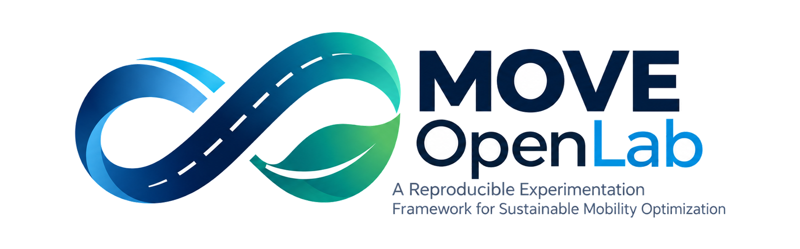
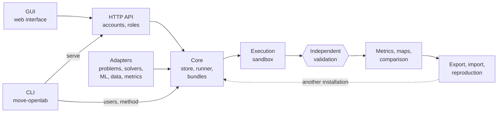
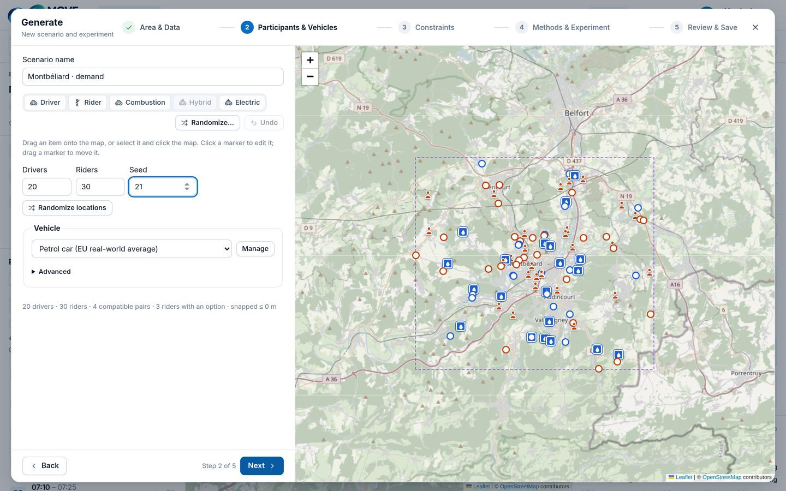
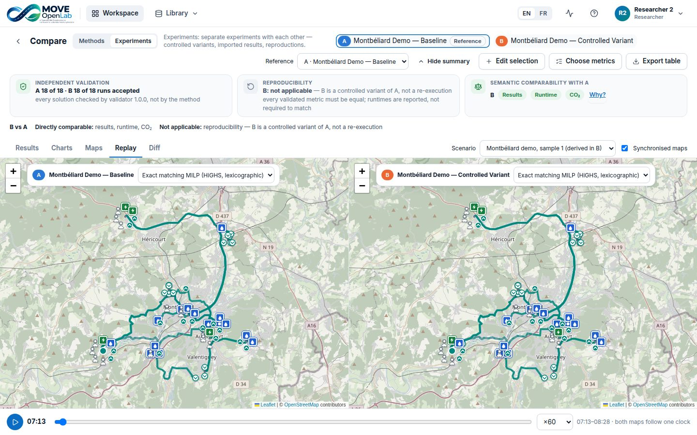
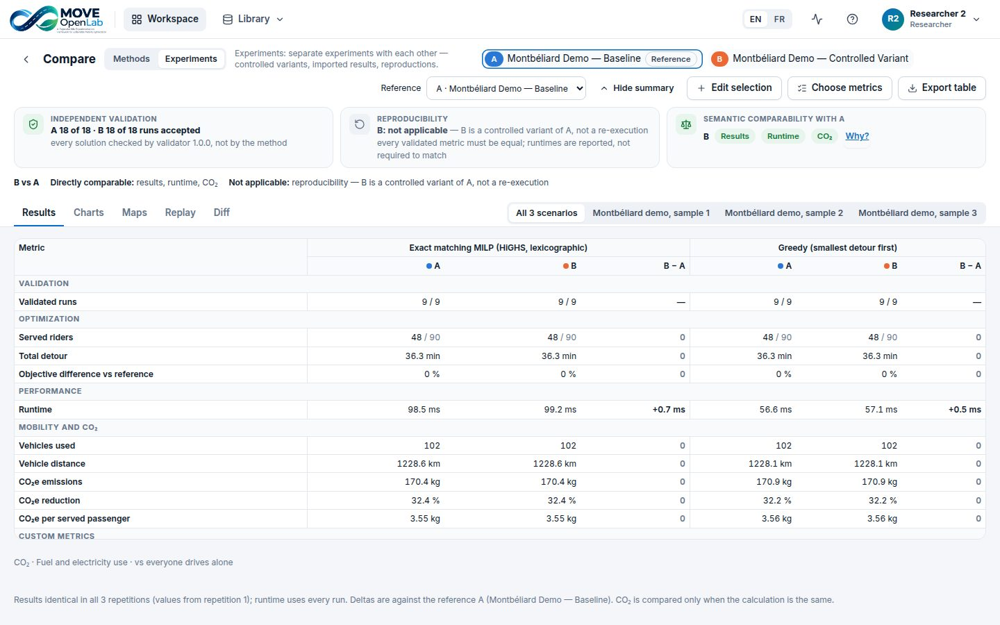
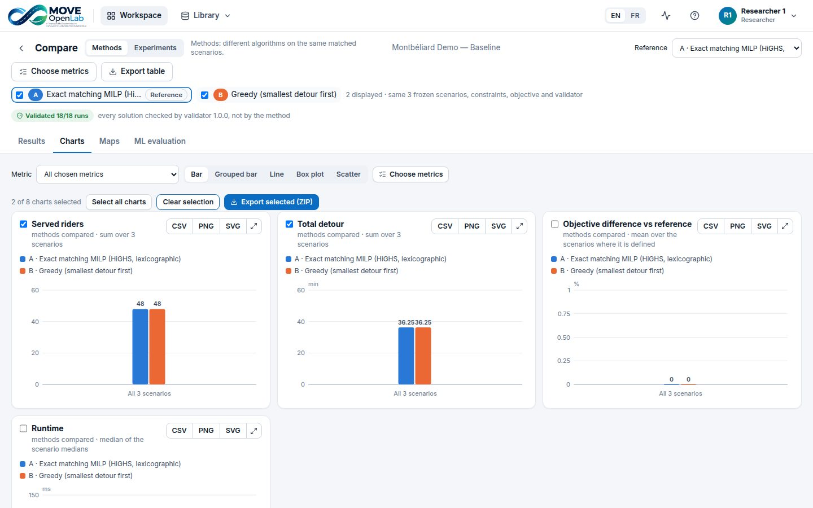
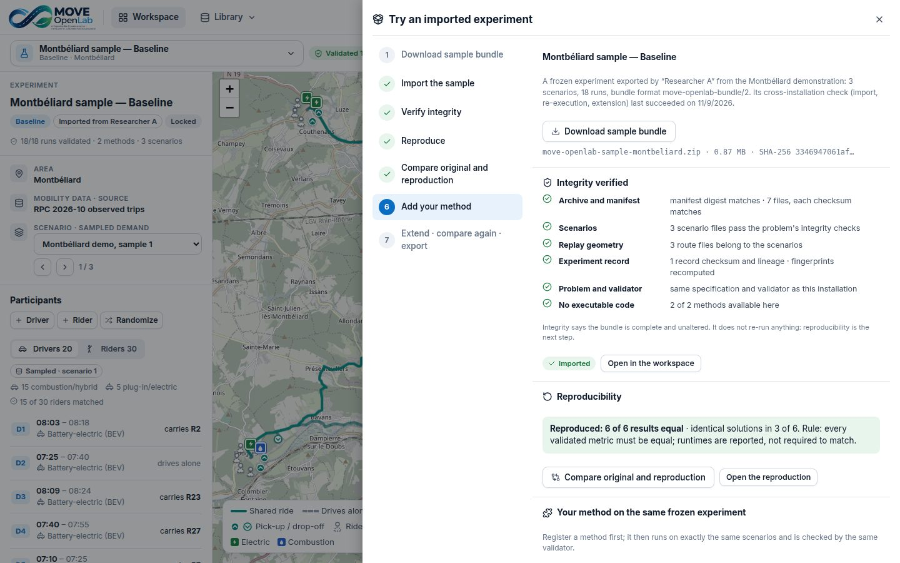

<p align="center">
  
</p>

<h1 align="center">MOVE OpenLab</h1>

<p align="center">
  <b>A Reproducible Experimentation Framework for Sustainable Mobility Optimization</b><br>
  Conceived, designed, developed and implemented by <b>Dr. Okba BEN ATIA</b><br>
  <a href="https://www.linkedin.com/in/benatiaokba/">LinkedIn</a> · <a href="https://scholar.google.com/citations?user=n5zSD7QAAAAJ&amp;hl=en">Google Scholar</a> · <a href="https://github.com/OkbaBenatia">GitHub</a>
</p>

<p align="center">
  <a href="LICENSE"></a>
  
  
  
</p>

<p align="center">
  <a href="#installation-and-quick-start">Quick Start</a> ·
  <a href="#graphical-interface-gui">GUI</a> ·
  <a href="#command-line-interface-cli">CLI</a> ·
  <a href="#key-features">Features</a> ·
  <a href="#public-demonstration">Public Demo</a> ·
  <a href="#architecture-and-adapters">Adapters and Plug-ins</a> ·
  <a href="#compare-methods-and-experiments">Scientific Comparison</a> ·
  <a href="#import-export-and-reproducibility">Reproducibility</a> ·
  <a href="#documentation">Documentation</a> ·
  <a href="#citation">Citation</a>
</p>

MOVE OpenLab turns an optimization study on mobility into a **complete, checkable and shareable experiment**. Prepare
a scenario on a real road network, run built-in or your own methods, have **every solution re-checked by an
independent validator**, compare methods and experiments only where the comparison is scientifically meaningful, and
hand the whole experiment to a colleague who can **verify, reproduce and extend it** on their own installation.


<sub>The Workspace with the public Montbéliard demonstration. Map tiles © OpenStreetMap contributors. Every screenshot
in this repository comes from a local run of the public application with synthetic accounts; details may differ from
the current interface.</sub>

## Why MOVE OpenLab?

Optimization results in mobility research are hard to check and harder to reproduce: scenarios are rebuilt by hand,
feasibility is taken from the method's own report, and two tables are compared although they were produced under
different data, constraints or hardware. MOVE OpenLab makes the whole chain explicit and verifiable:

```
Data → Scenario → Method → Solver → Validation → Metrics → Visualization → Comparison → Export → Reproduction
```

1. **One experiment, end to end** — area, mobility data, participants, vehicles, constraints, methods and results
   are one versioned object, not a folder of scripts.
2. **Real geography** — any area covered by OpenStreetMap, travel times and routes on its road network, results on
   the map.
3. **Independent validation** — every solution is re-checked by the problem's own validator; self-reported values
   are compared, never trusted.
4. **Frozen, content-addressed scenarios** — each instance has a fingerprint; locked results carry checksums.
5. **Claim-specific comparability** — results, runtimes and CO₂ are each declared directly comparable, comparable
   with conditions, or not comparable, with the reasons.
6. **Reusable adapters** — problems, solvers, learned methods, datasets and metrics plug in through documented
   contracts.
7. **Your method in minutes** — register a ready-made plug-in, upload a completed one, or generate a template; every
   plug-in runs in a verified sandbox with its code pinned by SHA-256.
8. **Scientific metrics, including ML and CO₂** — chosen per account, computed from validated decisions, never
   shown as zero when they are not available.
9. **Portable evidence** — a bundle carries records and checksums, never code; a colleague verifies it before
   anything is stored and can re-execute it to obtain a *Reproduced* verdict.
10. **GUI and CLI on the same core** — point-and-click for studies and demonstrations, commands for method
    development and automation.

## Key features

| Area | What you get |
|---|---|
| Map-first Workspace | Area, data and experiment on one screen; participants, vehicles and routes on the map; run, compare, replay, export |
| Scenario authoring | Five-step wizard (Area & Data → Participants & Vehicles → Constraints → Methods & Experiment → Review & Save); seeded *Randomize*; drag-and-drop placement of drivers and riders; vehicle profiles per driver |
| Methods | Exact MILP (HiGHS) and a greedy heuristic built in; *+ Add method* with a catalogue of ready-made plug-ins, secure upload of a completed plug-in, and a generated template |
| Independent validation | The problem's validator re-checks every solution; results show *n of n runs validated* |
| Metrics | Groups Optimization, ML, Performance, Mobility and emissions, Custom; *Choose metrics* kept per account and problem |
| ML evaluation | Confusion matrix, threshold curve and derived measures for learned methods; import of external evaluation evidence |
| CO₂ | Sourced, editable vehicle parameters; explicit scope and baseline; computed from validated decisions |
| Compare | *Methods* and *Experiments* tabs: results, charts (CSV, PNG, SVG), two synchronised maps, replay, diff, comparability per claim |
| Benchmarks | A fixed public protocol anyone can repeat and compare run by run |
| Exchange | Verified experiment bundles and scenario packages; import, revalidation, re-execution, *Reproduced* verdict |
| Accounts | Administrator, Researcher and Student roles; one isolated workspace per account; audit log |
| Language | English and French |

## Two complementary interfaces: GUI and CLI

The graphical interface and the `move-openlab` command reach **the same core**, the same sandbox and the same
independent validator. The GUI is where studies are prepared, run, compared and exchanged; the CLI is where method
developers generate, test and automate. Neither replaces programming a new algorithm: the scientific rule of a new
method is written in Python by its author.



### Graphical interface (GUI)

| Prepare | Run and validate | Compare and exchange |
|---|---|---|
| Areas and road networks, mobility datasets, the Generate wizard, seeded *Randomize*, drag-and-drop participants, vehicle profiles, constraints | Built-in methods, ready-made plug-ins, methods from a template, solver settings and time limits, thresholds of learned methods, background runs with progress, independent validation | Metrics and charts, ML evaluation, CO₂, Compare Methods, Compare Experiments, synchronised maps and route replay, export and import, re-execution across accounts |

| Scenario authoring | Synchronised maps and replay | Compare experiments |
|---|---|---|
|  |  |  |
| **Charts** | **ML evaluation** | **Reproduced** |
|  |  |  |

More screenshots: **[docs/GALLERY.md](docs/GALLERY.md)**.

### Command-line interface (CLI)

Installed in `.venv` by `./start-local.sh` (or `pip install -e .`). Every command below is part of the current
implementation (`move-openlab --help`).

```bash
# Start the application (start-local.sh prepares the environment, then runs this)
.venv/bin/move-openlab serve --host 127.0.0.1 --port 8765

# Accounts: temporary password printed once, forced change at first sign-in
.venv/bin/move-openlab users add alice --display-name "Alice" --role researcher
.venv/bin/move-openlab users reset-password alice

# Create a method from the template, then check it
.venv/bin/move-openlab method new my_method --problem public-ride-matching --dir plugins
.venv/bin/move-openlab method check plugins/my_method
.venv/bin/move-openlab method check plugins/my_method --bundle sample_experiment.zip --json
```

| Command | Use |
|---|---|
| `method new <name> --problem <id> [--dir] [--kind exact\|heuristic\|learned\|hybrid] [--display-name] [--author] [--description]` | Creates `plugin.py`, `test_plugin.py` and a `README.md` with the integration structure |
| `method check <path> [--bundle file.zip] [--json]` | Reads the metadata without running it, runs the self-test in the sandbox and, with a bundle, solves its instances and has every run validated next to the experiment's own methods |
| `users add` / `users reset-password` | Operator account management on the host |
| `serve [--host] [--port]` | The application server (API and interface) |

Scripts for scriptable workflows: `scripts/pack_examples.py` rebuilds the sample packages byte for byte;
`scripts/benchmark_synthetic_assignment.py --out <dir>` reproduces the public synthetic benchmark through the
platform's own pipeline. Plug-ins need Linux with bubblewrap (see [Installation](#installation-and-quick-start)).

## Architecture and adapters

The core knows experiments, methods, validation, comparison and bundles; it does not know what a driver or a route
is. Everything domain-specific plugs in:

| Adapter | Contract | Guide |
|---|---|---|
| Problem package | scenarios, objective, independent validator, metrics; entry point `move_openlab.problems` | [docs/ADAPTERS.md](docs/ADAPTERS.md) |
| Solver or heuristic | `solve(instance, config)` returning decisions; any solver library importable in the installation | [docs/SOLVER_INTEGRATION.md](docs/SOLVER_INTEGRATION.md) |
| Learned or hybrid method | candidate scoring, threshold, ML evaluation | [docs/ML_INTEGRATION.md](docs/ML_INTEGRATION.md) |
| Dataset provider | normalised trips; entry point `move_openlab.dataset_providers` | [docs/DATASETS.md](docs/DATASETS.md) |
| Metric | built-in or custom, computed from validated inputs | [docs/METRICS.md](docs/METRICS.md) |

Two public problems ship with the framework: ride matching on OpenStreetMap road networks (the Montbéliard
demonstration) and a fully synthetic capacitated assignment benchmark. All diagrams: [docs/DIAGRAMS.md](docs/DIAGRAMS.md).

## Three ways to add a method

*+ Add method* offers three distinct routes. The GUI and the CLI use the same template, the same checks and the same
sandbox.

| Route | When | Workflow |
|---|---|---|
| **Built-in methods** | A method shipped with the problem package fits | Select → configure → run → validate → compare |
| **Register my method** | A compatible plug-in already exists (ready-made example, approved folder, or your completed `.zip`) | Select in the catalogue → *Check compatibility* → *Register* → run → validate → compare. No template needed |
| **Create from template** | You are writing a new method | Choose the problem → name the method → *Generate the template (.zip)* → implement `solve(instance, config)` → *Upload* and check → register → run → validate → compare |

The catalogue shows, for each plug-in, its name, version, kind, author, supported problem and objective, where it
comes from, its compatibility and registration status, and its code SHA-256; every plug-in runs in the sandbox, which
requires Linux with bubblewrap. The verified public example is **Nearest Pickup First**: select it, register
it, run it on the demonstration, see every run validated, and compare it with the built-in methods. A completed plug-in
is uploaded as a `.zip`: its metadata is read without running it, its self-test runs in the sandbox, its code is
pinned by SHA-256, and it is stored in the uploader's workspace only.

The template supplies the **integration structure** — metadata, the `solve` entry point, a self-test — not a trained
model and not a finished scientific algorithm. A valid (feasible) result is not a proof of optimality.

| Register my method: Nearest Pickup First | Create from template |
|---|---|
|  |  |

Step by step: [docs/ADD_YOUR_METHOD.md](docs/ADD_YOUR_METHOD.md) · contracts: [docs/EXTENDING.md](docs/EXTENDING.md).

## Public demonstration

*Montbéliard Demo — Baseline* and *Montbéliard Demo — Controlled Variant* open on first sign-in: three scenarios of 20
drivers and 30 riders resampled with fixed seeds from a frozen release of open French carpooling data in the Pays de
Montbéliard, travel times and distances on the OpenStreetMap road network, an exact MILP and a greedy heuristic. The
variant lowers the detour limit without removing any compatible pair, so its results are directly comparable with the
baseline. Provenance, vehicle parameters and licences: [src/move_openlab/demo/README.md](src/move_openlab/demo/README.md);
a scripted walkthrough: [docs/DEMO_GUIDE.md](docs/DEMO_GUIDE.md).

## Scenario authoring

Search a place, click the map or draw a box; load its road network; import open carpooling data (France), a CSV with
explicit column mapping, GeoJSON, or seeded synthetic demand. The Generate wizard builds a scenario step by step;
in the Workspace, *Randomize* draws drivers and riders with a seed, participants are added or moved by drag and drop,
and each driver gets a vehicle profile. Editing a locked experiment creates a new scenario version; locked results are
never changed. Details: [docs/DATASETS.md](docs/DATASETS.md).

## Independent validation

Every decision set returned by a method — built-in, registered or uploaded — passes the problem's independent
validator before it is stored. Feasibility, served riders, detours and every reported figure are recomputed; a value
reported by the method that disagrees is flagged, never used. Imported results are validated again by the importing
installation.

## Scientific metrics and ML evaluation

*Choose metrics* selects what results and charts show, from the groups Optimization, ML, Performance, Mobility and
emissions, and Custom. A metric the problem cannot provide reads *Not configured* or *Not available*, never zero. For
learned methods, the ML evaluation shows the confusion matrix, threshold curve and derived measures; external
evaluation evidence can be imported (a synthetic example is in `examples/ml-evaluation/`). CO₂ is computed from the
validated decisions under an explicit scope and baseline, with every vehicle parameter sourced and editable.
Details: [docs/METRICS.md](docs/METRICS.md), [docs/ML_INTEGRATION.md](docs/ML_INTEGRATION.md).

## Maps, routes and replay

Validated routes are drawn on the road network, with pick-ups, drop-offs, unmatched riders and vehicle types. *Replay
routes* animates the solution on one clock; Compare shows two synchronised maps side by side. Details:
[docs/MAPS.md](docs/MAPS.md).

## Compare methods and experiments

One *Compare* entry, two tabs. **Methods**: results, charts, two synchronised maps and the ML evaluation of the methods
of one experiment. **Experiments**: two experiments matched scenario by scenario through their frozen instances, with
validation, reproducibility and **semantic comparability per claim** (results, runtime, CO₂) kept as separate
statements, then results, charts, maps, replay and a diff. Charts export as CSV, PNG and SVG. Details:
[docs/REPRODUCIBILITY.md](docs/REPRODUCIBILITY.md).

## Benchmarks

*Library › Benchmarks → Run the public benchmark* runs a fixed protocol — predefined synthetic scenarios, methods,
repetitions, validator and an independent oracle — that anyone can repeat and compare run by run. *Compare* analyses
experiments you choose; a benchmark is the same protocol for everyone. Command-line equivalent:
`scripts/benchmark_synthetic_assignment.py`.

## Import, export and reproducibility

1. **Export** — *Export → Lock and export* writes one `.zip` bundle with its SHA-256: records, fingerprints and
   checksums, never code; optionally the imported ML evaluation evidence or references to it.
2. **Import** — every checksum, fingerprint, problem specification and validator version is verified before anything
   is stored; the experiment is marked *Imported*, never *executed here*.
3. **Revalidate** — every imported run is checked again by this installation's validator.
4. **Reproduce** — *Run again* re-executes the same methods on the same frozen scenarios; the verdict is *Reproduced*
   when every validated figure is identical (runtimes are reported, not required to match).
5. **Extend** — add your method to the imported experiment and compare it on exactly the same scenarios.

Details: [docs/IMPORT_EXPORT.md](docs/IMPORT_EXPORT.md), [docs/REPRODUCIBILITY.md](docs/REPRODUCIBILITY.md),
[docs/MULTI_USER.md](docs/MULTI_USER.md).

## MOVE OpenLab in the research software ecosystem

MOVE OpenLab is **complementary** to specialised tools. It is neither an optimization solver nor a general machine
learning tracking platform; it is a domain-specific experimentation environment for mobility optimization in which
such tools can be used. Roles below are summarised from each project's official documentation.

| Software | Role, according to its official documentation | Relation to MOVE OpenLab |
|---|---|---|
| [Benchopt](https://github.com/benchopt/benchopt) | A framework for reproducible, comparable benchmarks of machine learning and optimization methods, extended by adding datasets, solvers or metrics | Shares the goal of transparent, repeatable benchmarking; MOVE OpenLab focuses on mobility scenarios, maps, independent validation and experiment exchange between accounts |
| [MLflow](https://mlflow.org/docs/latest/ml/) | An open-source platform for the machine learning lifecycle: experiment tracking, model packaging, registry and deployment | Tracks ML experiments in general; MOVE OpenLab records optimization experiments on frozen mobility scenarios and evaluates learned methods inside them |
| [Optuna](https://optuna.org/) | An open-source framework that automates hyperparameter search | Can tune a method's parameters outside the platform; MOVE OpenLab then runs, validates and compares the resulting method |
| [Google OR-Tools](https://developers.google.com/optimization) | An open-source software suite for optimization, including vehicle routing, flows, integer and linear programming and constraint programming | A solver library: it can be the engine inside a MOVE OpenLab method, which then adds scenarios, validation, metrics, comparison and provenance around it |

The same applies to commercial mathematical-programming solvers: a method may call any solver library that is
installed and licensed in its environment ([docs/SOLVER_INTEGRATION.md](docs/SOLVER_INTEGRATION.md)).

What MOVE OpenLab brings together in one application: mobility scenario preparation, geographic visualization,
reusable optimization and ML adapters, independent validation, claim-specific semantic comparability, scientific
metrics, controlled benchmarks, provenance and versioning, reproducibility, GUI and CLI, and cross-account experiment
exchange.

## Installation and quick start

**Requirements** (tested in CI on Ubuntu): Linux; Python 3.11 or 3.12; Node.js 20.19+ or 22.12+; git and curl;
bubblewrap for sandboxed plug-ins. On Ubuntu:

```bash
sudo apt update
sudo apt install -y git curl python3 python3-venv bubblewrap
node --version   # 20.19+ or 22.12+
```

**Install and start:**

```bash
git clone https://github.com/OkbaBenatia/move-openlab-framework.git
cd move-openlab-framework
./start-local.sh
```

The first run creates `.venv`, installs the package, builds the interface (network access needed once) and starts
the complete application at **http://127.0.0.1:8765**, reachable from this computer only. `./start-local.sh --check`
prepares and checks without starting; **Ctrl+C** stops it. Later runs start in seconds and keep every account,
experiment and result of the local data directory `.openlab-data/dev`.

**First sign-in.** There is no default password and no self-registration. On an empty installation a first
administrator `admin` is created with a random temporary password, written to `.openlab-data/dev/dev-credentials.json`
(readable by you only) and never printed. Sign in at http://127.0.0.1:8765 and choose your own password; create
further accounts under *Administration* or with `move-openlab users add`.

On recent Ubuntu releases the plug-in sandbox may need unprivileged user namespaces; without them everything except
plug-ins works, and plug-ins are refused with the reason. Every option, manual installation and production mode:
[docs/INSTALL.md](docs/INSTALL.md) · problems and fixes: [docs/TROUBLESHOOTING.md](docs/TROUBLESHOOTING.md).

## Public sample downloads

| | Sample scenario | Sample experiment |
|---|---|---|
| Content | one frozen scenario of the demonstration (20 drivers, 30 riders), no results | an exported experiment with results (3 scenarios, 2 methods, 18 validated runs) |
| File | `sample_scenario.zip` (`move-openlab-scenario/1`) | `sample_experiment.zip` (`move-openlab-bundle/2`) |
| Use | verify, import, choose methods, run, validate | verify, import, compare, reproduce, add your method |

Both packages are built into the application (*Import ▾ → Try a sample*, no download needed). They are also rebuilt
byte for byte from a clone, with their checksums:

```bash
.venv/bin/python scripts/pack_examples.py
cd examples && sha256sum -c SHA256SUMS
```

The two `.zip` files and `SHA256SUMS` are intended to be attached to each GitHub release as release assets. A
synthetic trip dataset (`examples/scenario-import/`, CC0) and a synthetic ML evaluation file
(`examples/ml-evaluation/`) are in the repository. Details: [examples/README.md](examples/README.md).

## Research and publications

Publications describing MOVE OpenLab and studies that use it will be listed here once they are published. To cite
the software itself, see [Citation](#citation).

## For researchers, laboratories and industry

Possible uses include:

- **Researchers** — benchmark a new matching or routing method against exact and heuristic baselines on the same
  frozen scenarios, with validated figures ready for a paper and a bundle reviewers can reproduce.
- **Laboratories and teaching** — shared installations with per-account workspaces, student accounts, and
  experiments exchanged between team members.
- **Industry and public bodies** — explore carpooling or shared-mobility scenarios on a real territory, compare
  policies such as detour limits, and examine their CO₂ effect under documented assumptions.

## Security and private extensions

Plug-ins run in a bubblewrap sandbox without network or access to other data, and the sandbox fails closed. Accounts
have server-side password rules, roles and isolated workspaces; bundles never carry code and are verified before
anything is stored. An installation can add its own problem package and declare it *restricted*: an administrator
grants it to named accounts, and no role — including administrator — implies access. Everyone else sees nothing of
it. See [docs/SECURITY_MODEL.md](docs/SECURITY_MODEL.md), [docs/PRIVATE_EXTENSIONS.md](docs/PRIVATE_EXTENSIONS.md) and
[SECURITY.md](SECURITY.md) for reporting a vulnerability.

## Documentation

| Topic | Documents |
|---|---|
| Install and run | [INSTALL](docs/INSTALL.md) · [TROUBLESHOOTING](docs/TROUBLESHOOTING.md) · [MULTI_USER](docs/MULTI_USER.md) |
| Understand | [ARCHITECTURE](docs/ARCHITECTURE.md) · [DIAGRAMS](docs/DIAGRAMS.md) · [GALLERY](docs/GALLERY.md) · [REPRODUCIBILITY](docs/REPRODUCIBILITY.md) |
| Extend | [ADD_YOUR_METHOD](docs/ADD_YOUR_METHOD.md) · [EXTENDING](docs/EXTENDING.md) · [ADAPTERS](docs/ADAPTERS.md) · [SOLVER_INTEGRATION](docs/SOLVER_INTEGRATION.md) · [ML_INTEGRATION](docs/ML_INTEGRATION.md) |
| Data and results | [DATASETS](docs/DATASETS.md) · [METRICS](docs/METRICS.md) · [MAPS](docs/MAPS.md) · [IMPORT_EXPORT](docs/IMPORT_EXPORT.md) · [examples](examples/README.md) |
| Security | [SECURITY_MODEL](docs/SECURITY_MODEL.md) · [PRIVATE_EXTENSIONS](docs/PRIVATE_EXTENSIONS.md) · [SECURITY](SECURITY.md) |
| Demonstrate | [DEMO_GUIDE](docs/DEMO_GUIDE.md) · [TEAM_PRESENTATION_GUIDE](docs/TEAM_PRESENTATION_GUIDE.md) · [MANUAL_ACCEPTANCE](docs/MANUAL_ACCEPTANCE.md) |
| Contribute | [CONTRIBUTING](CONTRIBUTING.md) · [DEVELOPMENT](docs/DEVELOPMENT.md) · [GITFLOW](docs/GITFLOW.md) · [RELEASING](docs/RELEASING.md) · [CHANGELOG](CHANGELOG.md) · [Code of Conduct](CODE_OF_CONDUCT.md) |

**Project status:** development build `0.3.1`. Tested in CI on every change: the Python test suite, linting, the
interface build with type check and unit tests, the confidentiality check and browser journeys on synthetic data.
Interfaces may still change before 1.0.0. Contributions follow GitFlow; see [CONTRIBUTING.md](CONTRIBUTING.md).

## Citation

If you use MOVE OpenLab in your research, please cite the software. Citation metadata is in
[CITATION.cff](CITATION.cff) (GitHub shows it under *Cite this repository*).

```bibtex
@software{benatia_move_openlab,
  author  = {BEN ATIA, Okba},
  title   = {{MOVE OpenLab: A Reproducible Experimentation Framework for Sustainable Mobility Optimization}},
  version = {0.3.1},
  license = {Apache-2.0},
  url     = {https://github.com/OkbaBenatia/move-openlab-framework}
}
```

## Licence and third-party notices

The MOVE OpenLab framework — source code, documentation and example plug-ins — is licensed under the **Apache License,
Version 2.0**: [LICENSE](LICENSE), [NOTICE](NOTICE).

Data and assets shipped with it keep their own licences and are not covered by the Apache License: road networks,
travel times and route geometry derived from OpenStreetMap (© OpenStreetMap contributors, ODbL 1.0); demonstration
participants resampled from the French carpooling registry open data (Licence Ouverte / Open Licence, Etalab); the
synthetic trip dataset (CC0 1.0); the Inter typeface (SIL Open Font License 1.1); the MOVE OpenLab name and logo (the
project's marks). Details: [THIRD_PARTY_NOTICES.md](THIRD_PARTY_NOTICES.md).

## Introduction video — coming soon

A short introduction video will be published here after the first public release.

<!-- VIDEO: reserved for the introduction video of the released version, to be supplied by the maintainer. -->

---

<p align="center">
  <b>MOVE OpenLab</b> — developed entirely by <b>Dr. Okba BEN ATIA</b><br>
  Université Marie et Louis Pasteur — FEMTO-ST Institute, DISC Department, OMNI team<br>
  <a href="https://www.linkedin.com/in/benatiaokba/">LinkedIn</a> · <a href="https://scholar.google.com/citations?user=n5zSD7QAAAAJ&amp;hl=en">Google Scholar</a> · <a href="https://github.com/OkbaBenatia">GitHub</a> · okba.ben_atia@univ-fcomte.fr
</p>
