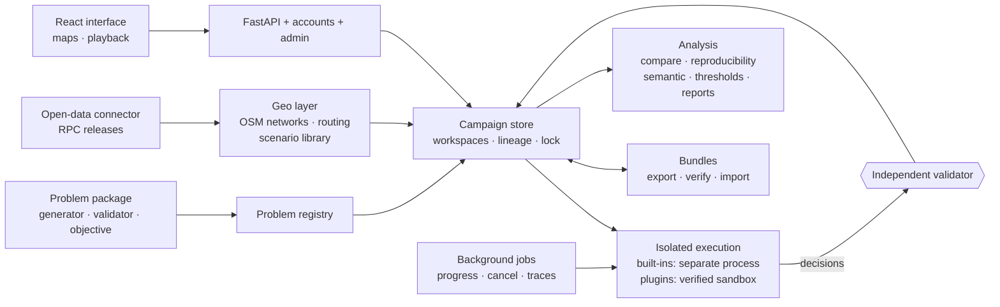
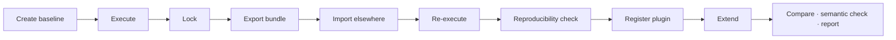

<!-- LOGO: reserved for the authentic MOVE OpenLab logo (docs/assets/), to be supplied by the maintainer. -->

# MOVE OpenLab

**A reproducible experimentation framework for optimization research.**

MOVE OpenLab runs optimization methods on versioned scenario sets, validates every solution independently, locks
results as checksummed campaigns, and moves them between researchers as verified bundles. A second researcher can
re-execute an experiment on their own installation, extend it with their own method, and compare all results under
explicit, claim-dependent comparability rules.

> **Status: pre-release (0.2.0).** The framework, web interface, the two public benchmarks, maps and the open-data
> connector are functional and tested.
> The licence, logo, demonstration video and screenshots are being prepared for the first public release.

<!-- DEMO VIDEO: reserved for the demonstration video, to be supplied by the maintainer. -->

## Main capabilities

| Capability | What it guarantees |
|---|---|
| Problem-agnostic core | A benchmark is a `Problem` package (spec, generator, validator, objective levels, metrics) registered through entry points |
| Content-addressed scenarios | Deterministic generators; every instance is identified by the SHA-256 of its canonical content |
| Method adapters | One contract for built-in methods and researcher plugins: `solve(instance, config) → decisions, status, declared, metadata, diagnostics` |
| Independent validation | Feasibility and every metric are recomputed from the instance and the decisions; self-reported values are only compared |
| Campaigns and lineage | Baseline, reproduction, extension, controlled variant and threshold-study campaigns; each derived campaign records its parent's checksum |
| Locking | Locked campaigns carry a checksum re-verified on every read; locked and imported campaigns are read-only |
| Export / import | Bundles with a manifest and per-file hashes (member files deterministic, only the export timestamp varies), no executable code, fully verified before anything is stored |
| Reproducibility | Cell-by-cell verification of an independent re-execution: identical solution, equal objective, or different |
| Comparison | Lexicographic ranking, matches with the reference optimum, shortfall and gaps against a reference method, per-group results |
| Optimality scope | Every result states what it proves: proven optimal (full problem), optimal for the reduced instance only, not proven, heuristic, or invalid |
| Semantic comparability | Problem fingerprints distinguish *same file* from *same problem*; quality and runtime claims get separate verdicts with reasons |
| Scoring and thresholds | Candidate scorers; fixed score thresholds or dynamic thresholds (best-scored share per instance, ties kept); top-k; threshold studies with candidate reduction, effective thresholds, recall, gaps and a chart |
| Maps and road networks | OpenStreetMap road networks fetched for an area, routing, interactive scenario map editor, route playback of solutions |
| Open data | Connector for the French national carpooling proof registry (RPC) releases: streaming download, cleaning with counted rejections, provenance and licence records |
| Scenario library | Scenarios from the map editor, a seeded generator or open-data distributions; edits create new versions that keep their provenance |
| Jobs and traces | Long operations run as persistent background jobs with progress, cancellation, per-stage traces, history and replay |
| Reports | Markdown and CSV comparison reports, JSON campaign records |
| Secure extensions | Plugins off by default; when enabled, run in a verified bubblewrap sandbox and refused if it is unavailable |
| Accounts and administration | Local accounts, signed sessions, one private workspace per researcher; administrators create, deactivate and reset accounts (audited) without access to other workspaces |

## Architecture and experimentation pipeline





Details: [docs/ARCHITECTURE.md](docs/ARCHITECTURE.md).

## Installation and quick start

Requirements: Python ≥ 3.11 and Node.js ≥ 20. For sandboxed plugins: Linux with bubblewrap (`bwrap`) and
unprivileged user namespaces.

```bash
python -m venv .venv && .venv/bin/pip install -e ".[dev]"
```

```bash
cd frontend && npm ci && npm run build && cd ..
```

```bash
.venv/bin/move-openlab users add alice --display-name "Alice" --role admin
```

```bash
.venv/bin/move-openlab serve
```

Open http://127.0.0.1:8765 and sign in with the temporary password printed by `users add`; you will be asked to
choose a personal password. Administrators manage further accounts in the web interface; an operator on the host can
recover a locked-out account with `move-openlab users reset-password <username>`. To enable the example researcher
plugin in the sandbox:

```bash
MOVE_OPENLAB_PLUGIN_DIR=plugins MOVE_OPENLAB_PLUGIN_MODE=sandbox .venv/bin/move-openlab serve
```

Configuration variables are listed in `src/move_openlab/settings.py` (data and plugin directories, plugin mode,
session secret, map tile server and attribution, Overpass endpoint).

## Reproducibility and semantic comparability

Every number shown by MOVE OpenLab is recomputed from locked records: instances are content-addressed, methods are
identified by id, version and (for plugins) code hash, and every run is re-validated. A reproduction campaign
re-executes the methods on the imported instances and is compared cell by cell with the original.

Comparing two results is valid only for a stated claim. MOVE OpenLab computes a problem fingerprint from the data that
define the feasible region and the objective, so that a non-binding change (a different file describing the same
problem) is distinguished from a real change of problem; differences in evaluation contract, time budget, method
options and execution environment qualify or invalidate a quality or runtime claim.
See [docs/REPRODUCIBILITY.md](docs/REPRODUCIBILITY.md).

## Verified synthetic benchmark

The first benchmark is a fully synthetic capacitated assignment problem (artificial drivers, passengers, time windows
and costs; maximise served passengers, then minimise cost). It ships an exact two-stage MILP (HiGHS), a deterministic
greedy heuristic, an example researcher plugin (regret-2 greedy), controlled variants and a transparent scorer. The
test suite certifies the exact method against brute force and an independent min-cost-flow oracle. It is a
methodological benchmark, not evidence about real-world mobility.

Output of `python scripts/smoke_synthetic.py` (default scenario set: 3 sizes × 10 seeds, two installations; objective
values are deterministic, run times are not reported here):

| Method | Served | Cost | Equals the proven optimum |
|---|---|---|---|
| Exact MILP (HiGHS) | 467 | 126 928 | 30 / 30 |
| Regret-2 greedy (plugin, sandboxed) | 460 | 128 249 | 16 / 30 |
| Deterministic greedy | 402 | 90 384 | 7 / 30 |

Independent re-execution in the second installation: 60 / 60 cells with identical solutions.

## Ride matching on road networks

The second benchmark matches riders to drivers on an OpenStreetMap road network (one rider per driver; maximise
served riders, then minimise the drivers' total detour; time windows and detour limits). Travel times come from the
stored road network and are recorded in the instance, so validation and re-execution never need the network. It ships
an exact two-stage MILP (HiGHS), a greedy heuristic, controlled variants and a transparent relative-detour scorer.

Scenarios come from three sources:

- **Map editor** — place drivers and riders on the map, preview routes, save; each edit is a new version.
- **Seeded generator** — synthetic demand on the road network, reproducible from its seed.
- **Open-data distribution** — drivers and riders resampled independently (seeded, with replacement) from the
  cleaned open carpooling records: each agent takes one record's origin–destination pair, as published, and a
  departure time re-drawn inside the publisher's 10-minute rounding interval; identifiers, dates, distances and
  operator classes are not carried over.

Areas are runtime configuration (a name and a bounding box chosen by an administrator); no area or data is bundled.

### Data sources, licences and usage policies

| Source | Licence and obligations | How MOVE OpenLab uses it |
|---|---|---|
| OpenStreetMap data (Overpass API) | © OpenStreetMap contributors, [ODbL 1.0](https://www.openstreetmap.org/copyright); attribution required; road graphs shared publicly must stay under the ODbL | Administrator-triggered fetch per area (≤ 0.25 deg², identifying User-Agent); network stored with query, timestamps and SHA-256 of the raw response |
| OpenStreetMap standard tiles | [Tile usage policy](https://operations.osmfoundation.org/policies/tiles/): light interactive use, visible attribution, no bulk download | Interactive maps only; set `MOVE_OPENLAB_TILE_URL` to your own or a commercial tile service for heavy or production use |
| RPC open data (data.gouv.fr) | [Licence Ouverte / Open Licence (Etalab)](https://www.data.gouv.fr/pages/legal/licences/etalab-2.0/); attribution with producer and update date; no re-identification | Administrator-triggered ingestion of one monthly release for one area; the full file is streamed and hashed, never stored; identifiers are dropped |

## Extension architecture

- **Method plugins** — one file with a literal `METADATA` and `solve()`; registered after static checks, code hash
  pinning and a sandboxed self-test.
- **Problem packages** — a `Problem` subclass registered under the `move_openlab.problems` entry point.
- **Scenario sources** — the RPC connector (`move_openlab.integrations.rpc`) and the geo layer
  (`move_openlab.geo`) are the reference implementations; further sources plug in through
  `move_openlab.integrations`.

See [docs/EXTENDING.md](docs/EXTENDING.md) and [docs/SECURITY_MODEL.md](docs/SECURITY_MODEL.md).

## Documentation

| Document | Content |
|---|---|
| [docs/ARCHITECTURE.md](docs/ARCHITECTURE.md) | Components, data model, pipeline |
| [docs/REPRODUCIBILITY.md](docs/REPRODUCIBILITY.md) | Hashes, fingerprints, determinism, what is and is not reproducible |
| [docs/EXTENDING.md](docs/EXTENDING.md) | Writing plugins and problem packages |
| [docs/SECURITY_MODEL.md](docs/SECURITY_MODEL.md) | Plugin sandbox, bundles, accounts, remaining risks |
| [docs/GITFLOW.md](docs/GITFLOW.md) | Branching model and repository settings |
| [docs/RELEASING.md](docs/RELEASING.md) | Release procedure |
| [CHANGELOG.md](CHANGELOG.md) | Version history |

## Contributing

Contributions follow GitFlow: branch from `develop`, open a pull request, and pass the tests and the
confidentiality gate. See [CONTRIBUTING.md](CONTRIBUTING.md), the [Code of Conduct](CODE_OF_CONDUCT.md) and the
[security policy](SECURITY.md) for vulnerability reports.

## Maintainer

Dr. Okba BEN ATIA — GitHub: [@OkbaBenatia](https://github.com/OkbaBenatia)

<!-- PROFILES: LinkedIn and Google Scholar links to be added once verified by the maintainer. -->

## Licence

The licence will be published with the first public release (pending final rights verification).
