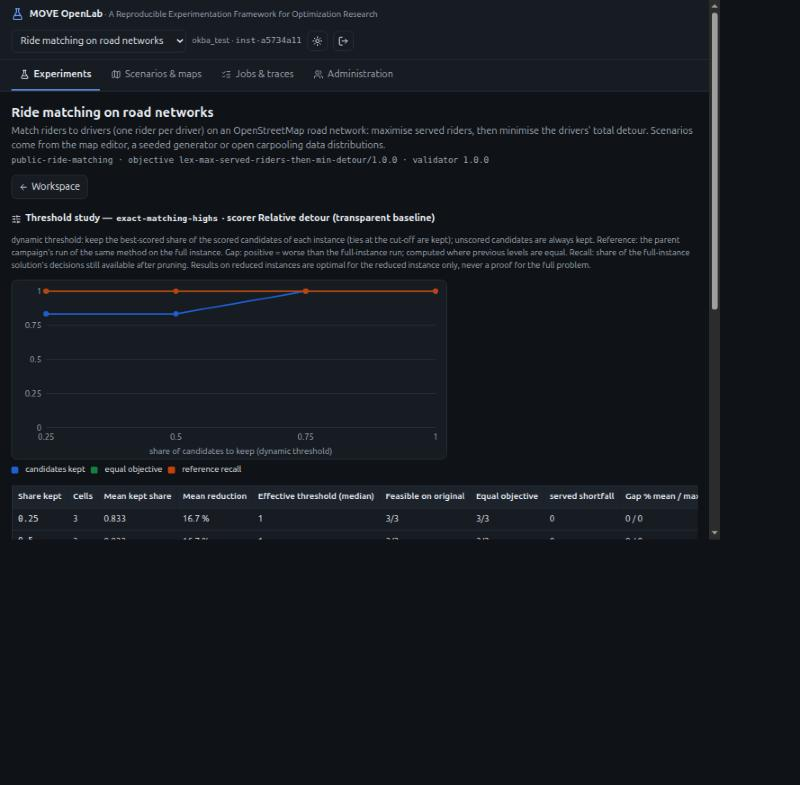
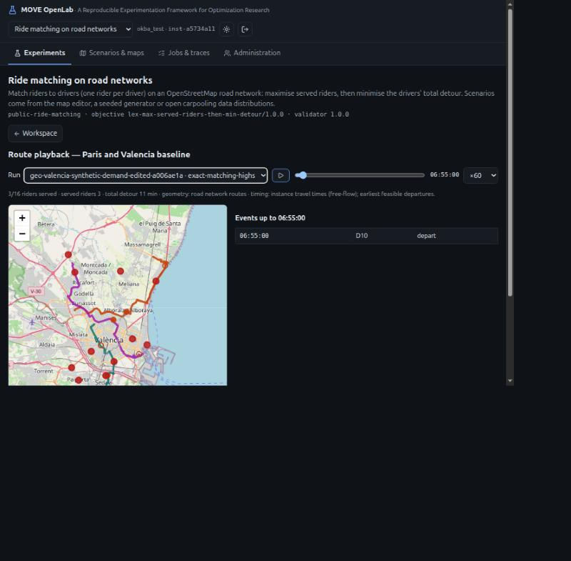
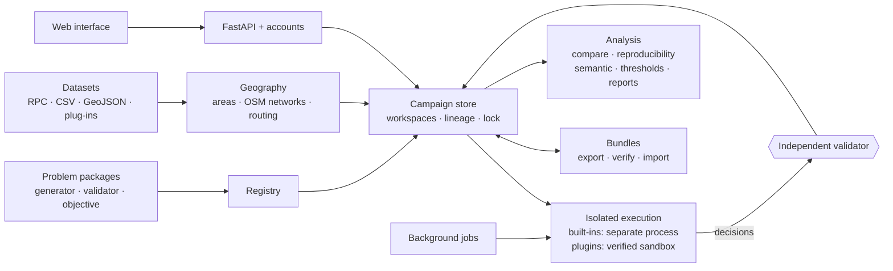
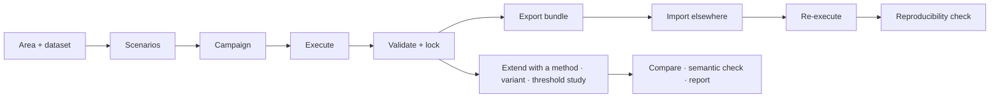

<!-- LOGO: reserved for the authentic MOVE OpenLab logo (docs/assets/logo.*), to be supplied by the maintainer. -->

# MOVE OpenLab

**A reproducible experimentation framework for optimization research.**

MOVE OpenLab runs optimization methods on versioned scenario sets, validates every solution independently, locks
results as checksummed campaigns and moves them between researchers as verified bundles. A second researcher can
re-execute an experiment on their own installation, extend it with their own method and compare all results under
explicit, claim-dependent comparability rules. Scenarios can be synthetic or built on real road networks anywhere
OpenStreetMap has data, from open data or from the researcher's own trip files.

> **Status: pre-release (0.2.0).** Functional and tested locally; licence, logo and demonstration video are being
> prepared for the first public release.

## Video demonstration

<!-- VIDEO: reserved for the 60–75 s demonstration video of the released version, to be supplied by the maintainer. -->
A short demonstration video will be published with the first release.

## Core features

| Area | What it provides |
|---|---|
| Experiments | Campaigns (baseline, reproduction, extension, controlled variant, threshold study) with lineage, locking and checksums |
| Validation | Every solution re-validated by the problem's own validator; self-reported values are only compared |
| Methods | Built-in exact and heuristic methods; researcher plugins in a verified sandbox (off by default) |
| Results | Lexicographic comparison, optimality-scope labels, gaps, per-group results; Markdown, CSV and JSON reports |
| Reproducibility | Verified bundles without code; independent re-execution compared cell by cell |
| Semantic comparability | Problem, evaluation and environment fingerprints; separate verdicts for quality and runtime claims |
| Candidate reduction | Scorers, fixed and dynamic (share) thresholds, top-k; threshold studies with reduction, recall and gaps |
| Geography | Areas anywhere (place search, map selection, adjustable box), road-network profiles, routing, coverage, route playback |
| Data | RPC open data (France), CSV and GeoJSON uploads with column mapping and validation, synthetic demand, provider plug-ins |
| Operations | Background jobs with progress, cancellation, stage traces and replay; accounts, administration and audit log |

## Screenshots

| Areas and routing (València) | Threshold study | Route playback |
|---|---|---|
|  |  |  |

Screenshots from a local run of this version; map tiles © OpenStreetMap contributors.

## Architecture



Details: [docs/ARCHITECTURE.md](docs/ARCHITECTURE.md).

## Experimentation pipeline



## Geographic and dataset flexibility

- **Any area.** Search a city or region, click the map or draw a box; resize it with handles; choose a road-network
  profile (all roads, main roads for larger areas, or a peak-hour speed factor). The network is downloaded once from
  OpenStreetMap and reused. Tested with Paris and València.
- **Any trip data.** RPC carpooling open data for areas in France; CSV files (encoding and delimiter detected,
  explicit column mapping, French and Spanish headers recognised); GeoJSON LineString or two-point MultiPoint
  features; seeded synthetic demand. Invalid rows are counted with reasons, never dropped silently.
- **Private by default.** Uploaded data stay in the researcher's workspace; shared resources carry no private names.

See [docs/DATASETS.md](docs/DATASETS.md) for formats, limits and the usage policies of OpenStreetMap, Nominatim,
Overpass and data.gouv.fr.

## Reproducibility and semantic comparability

Every number shown is recomputed from locked records: instances are content-addressed, methods are identified by id,
version and (for plugins) code hash, and every run is re-validated. A reproduction campaign re-executes the methods
on the imported instances and is compared cell by cell with the original.

A comparison is valid only for a stated claim. A problem fingerprint, computed from the data that define the
feasible region and the objective, distinguishes a non-binding change (a different file describing the same problem)
from a real change of problem; evaluation contract, time budget, method options and environment qualify or invalidate
quality and runtime claims. Each result states what it proves: proven optimal for the full problem, optimal for a
reduced instance only, not proven, heuristic or invalid. See [docs/REPRODUCIBILITY.md](docs/REPRODUCIBILITY.md).

## Installation

Requirements: Python ≥ 3.11, Node.js ≥ 20; for sandboxed plugins, Linux with bubblewrap.

```bash
python -m venv .venv && .venv/bin/pip install -e ".[dev]"
```

```bash
cd frontend && npm ci && npm run build && cd ..
```

## Quick start

```bash
.venv/bin/move-openlab users add alice --display-name "Alice" --role admin
```

```bash
.venv/bin/move-openlab serve
```

Open http://127.0.0.1:8765, sign in with the temporary password printed by `users add` and choose your own. Then:

1. *Scenarios & maps → Areas*: search a place or draw a box, save it, download its road network.
2. *Datasets* (optional): import RPC data for a French area or upload a CSV/GeoJSON file.
3. *Generate* or *Editor*: build scenarios; select them in the *Library* and create a campaign.
4. *Experiments*: execute, lock, compare, export, or start a threshold study.

Administrators add accounts under *Administration*. Development setup, configuration and tests:
[docs/DEVELOPMENT.md](docs/DEVELOPMENT.md).

## Verified synthetic benchmark

A fully synthetic capacitated assignment problem (artificial drivers, passengers, time windows and costs; maximise
served passengers, then minimise cost) with an exact two-stage MILP (HiGHS), a greedy heuristic, an example
researcher plugin (regret-2 greedy), controlled variants and a transparent scorer. The test suite certifies the exact
method against brute force and an independent min-cost-flow oracle. It is a methodological benchmark, not evidence
about real-world mobility.

Output of `python scripts/smoke_synthetic.py` (3 sizes × 10 seeds, two installations; objective values are
deterministic, run times are not reported here):

| Method | Served | Cost | Equals the proven optimum |
|---|---|---|---|
| Exact MILP (HiGHS) | 467 | 126 928 | 30 / 30 |
| Regret-2 greedy (plugin, sandboxed) | 460 | 128 249 | 16 / 30 |
| Deterministic greedy | 402 | 90 384 | 7 / 30 |

Independent re-execution in the second installation: 60 / 60 cells with identical solutions.

The second benchmark, **ride matching on road networks** (one rider per driver; maximise served riders, then minimise
the drivers' total detour), runs on any area's network with an exact MILP and a greedy heuristic. Travel times are
stored in each instance, so validation and re-execution never need the network.

## Extending MOVE OpenLab

| Extension | Guide |
|---|---|
| Method adapter (plugin) | [docs/EXTENDING.md](docs/EXTENDING.md#a-method-plugin-adapter) |
| Problem package | [docs/EXTENDING.md](docs/EXTENDING.md#a-problem-package) |
| Dataset provider | [docs/DATASETS.md](docs/DATASETS.md#writing-a-dataset-provider) |

None of them requires changing the core; plugins run in the verified sandbox ([docs/SECURITY_MODEL.md](docs/SECURITY_MODEL.md)).

## Documentation

| Document | Content |
|---|---|
| [docs/ARCHITECTURE.md](docs/ARCHITECTURE.md) | Components, data model, pipeline |
| [docs/DATASETS.md](docs/DATASETS.md) | Areas, road networks, dataset formats, limits, external services, providers |
| [docs/REPRODUCIBILITY.md](docs/REPRODUCIBILITY.md) | Hashes, fingerprints, determinism, what is and is not reproducible |
| [docs/EXTENDING.md](docs/EXTENDING.md) | Method adapters, problem packages, dataset providers |
| [docs/SECURITY_MODEL.md](docs/SECURITY_MODEL.md) | Sandbox, accounts, uploads, external services, remaining risks |
| [docs/DEVELOPMENT.md](docs/DEVELOPMENT.md) | Installation, configuration, tests |
| [docs/GITFLOW.md](docs/GITFLOW.md) | Branching model and repository settings |
| [docs/RELEASING.md](docs/RELEASING.md) | Release procedure and checklist |
| [CHANGELOG.md](CHANGELOG.md) | Version history |

## Contributing

Students, researchers, developers and companies are welcome. Contributions follow GitFlow: branch from `develop`,
open a pull request with tests and documentation, and pass CI and the confidentiality gate; pull requests are
reviewed, never merged automatically. See [CONTRIBUTING.md](CONTRIBUTING.md), the
[Code of Conduct](CODE_OF_CONDUCT.md) and the [security policy](SECURITY.md).

## Citation

<!-- CITATION: references and a CITATION.cff file will be added once the publication details are verified. -->
Citation information will be published with the first release.

## Licence

Intended licence: Apache License 2.0, subject to the final verification of ownership and third-party rights. The
licence file will be added before the first public release. Third-party data keep their own licences: OpenStreetMap
data © OpenStreetMap contributors (ODbL); RPC open data, Licence Ouverte / Open Licence (Etalab).

## Maintainer

Developed and maintained by **Dr. Okba BEN ATIA**
Université Marie et Louis Pasteur — FEMTO-ST Institute, DISC Department, OMNI team

- GitHub: [@OkbaBenatia](https://github.com/OkbaBenatia)
- Contact: okba.ben_atia@univ-fcomte.fr

<!-- PROFILES: LinkedIn, Google Scholar and ORCID links to be added once their exact URLs are verified. -->
