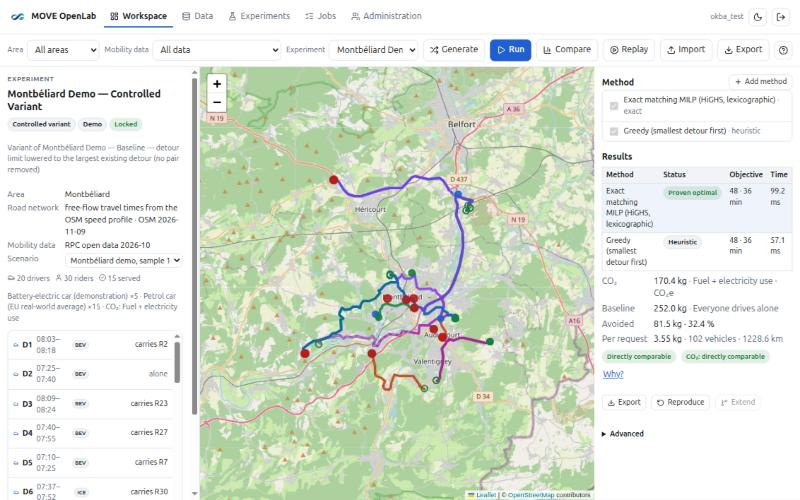
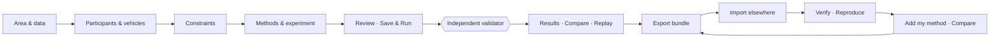
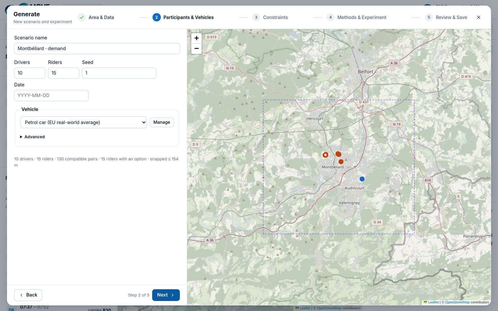
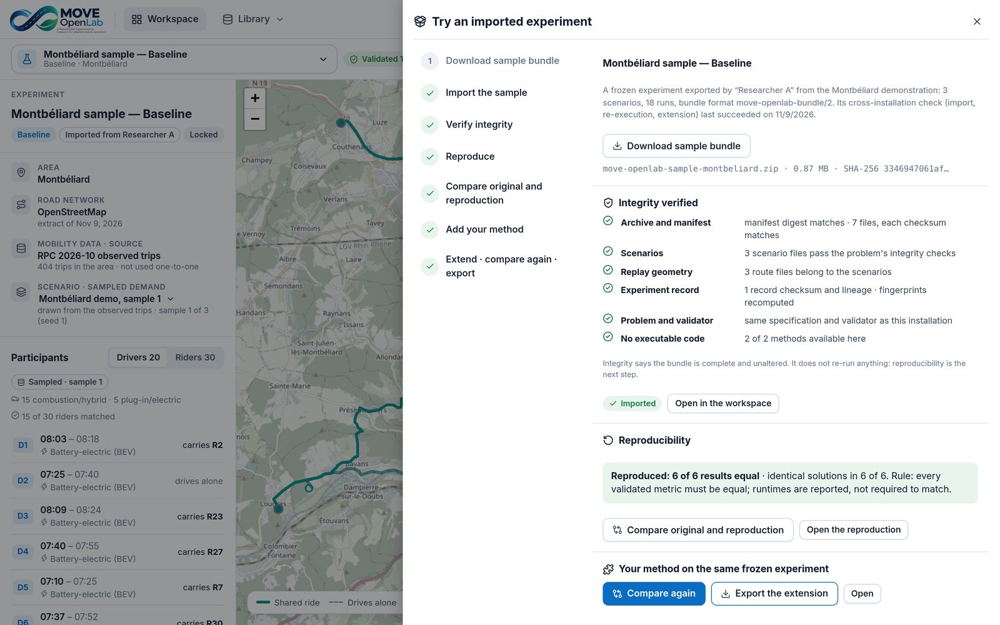
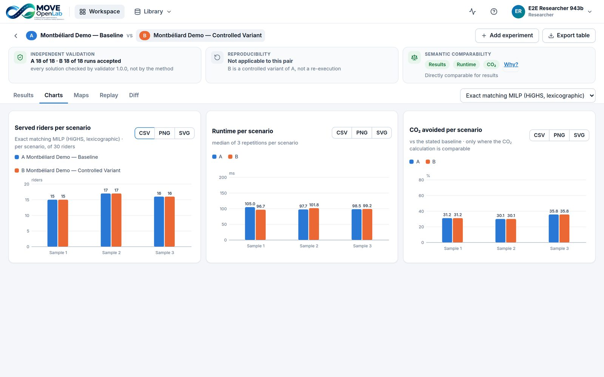
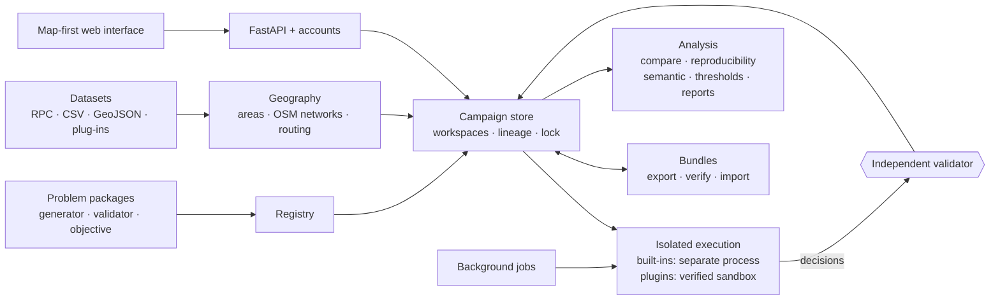

# MOVE OpenLab

**A reproducible experimentation framework for optimization research.**

Run optimization methods on real or synthetic scenarios, validate every solution independently, compare methods
fairly, and hand the whole experiment to a colleague who can reproduce it on their own machine and extend it with
their own algorithm.

> **Status: development build.** Functional and tested locally; the first official release will be **MOVE OpenLab 1.0.0**
> once the licence, the demonstration video and the release checklist in [docs/RELEASING.md](docs/RELEASING.md) are complete.

<!-- VIDEO: reserved for the 60–75 s demonstration video of the released version, to be supplied by the maintainer. -->



*The workspace on first sign-in: the Montbéliard demonstration with its provenance (area, road network, mobility data,
sampled scenario) on the left, shared rides on the map, methods, results with their measurement basis, CO₂ and the
evidence (independent validation, semantic comparability) on the right. Map tiles © OpenStreetMap contributors.*

## Start it on your computer

```bash
./start-local.sh
```

One command starts the complete application — server and interface in one process — at **http://127.0.0.1:8765**,
reachable from this computer only. The first run prepares what is missing (Python environment, interface build;
network access needed once) and, on an empty installation, creates a first administrator `admin` whose temporary
password is written to `.openlab-data/dev/dev-credentials.json` (never printed; you choose your own at the first
sign-in). Later runs start in seconds, rebuild the interface only when its sources changed, and keep every account,
experiment and result of the local data directory. A second start while it runs only reports the address; a port
used by another program is reported with a fix. **Ctrl+C** stops it cleanly. `./start-local.sh --check` prepares and
checks without starting. Requirements: Python ≥ 3.11 and Node.js 20.19+ or 22.12+; for your own methods (sandboxed
plug-ins), Linux with bubblewrap — without it, everything else works and plug-ins stay off.

## Why MOVE OpenLab

Comparing optimization methods fairly is hard: results depend on data, settings, solver versions and hardware, and
experiments rarely travel between labs intact. MOVE OpenLab makes the experiment the unit of work: frozen scenarios,
an independent validator, locked results with checksums, a portable bundle, and explicit rules saying when two
results may be compared.

## Core features

| | |
|---|---|
| Map-first workspace | Choose an area, mobility data and experiment; see participants, vehicles and routes on the map; run, compare, replay, export — on one screen |
| Generate wizard | Area & Data → Participants & Vehicles → Constraints → Methods & Experiment → Review & Save, over the map; *Save & Run* or *Save Scenario*; nothing is stored before you confirm |
| Built-in demonstration | Two experiments on Montbéliard (participants sampled from RPC open carpooling data, OpenStreetMap routing, documented vehicle parameters) open on first sign-in, ready to compare and replay |
| Sample bundle | A real exported experiment shipped with the platform: download it, verify it, import it, reproduce it, add your method and compare — the whole cycle in *Import → Try an imported experiment* |
| Methods | Exact MILP (HiGHS) and heuristics built in; *+ Add method* next to the method list registers your own sandboxed plugin or creates one from the template |
| Independent validation | Every solution re-checked by the problem's validator; self-reported values are only compared. Validation, reproducibility and semantic comparability are shown as three separate pieces of evidence |
| Vehicles and emissions | Vehicle profiles per driver (ICE, HEV, PHEV, BEV, custom); every emission parameter editable and sourced; explicit scope and baseline; CO₂, baseline and avoided CO₂ from validated decisions |
| Comparison | Concise table, charts of any supported metric (CSV, SVG, PNG export), what each result proves; *Compare with…* lists the directly comparable and conditionally comparable experiments first (incompatible ones under a fold, with the reasons); comparison workspace with synchronised maps, one replay clock, several experiments in one table and a solution diff |
| Reproducibility | Verified bundles without code: *Export* says what the bundle contains, *Import* inspects it completely before anything is stored; re-execution compared cell by cell; lineage of every experiment |
| Semantic comparability | *Directly comparable*, *comparable with conditions* or *not comparable* — for results, runtimes and emissions — with the reasons |
| Replay and trace | Vehicles, pickups, drop-offs, served and unserved riders over time; the execution timeline of every run |
| Geography and data | Any area OpenStreetMap covers; RPC open data (France), CSV, GeoJSON, synthetic demand, provider plug-ins |
| Operations | Background jobs with progress in plain words — runs: Queued → Preparing → Running methods → Validating → Results; road networks: Queued → Downloading → Building → Ready — with cancellation and the execution trace; audit log |
| Accounts | Administrator, Researcher and Student roles; credential store and audit log owner-only (0600); a researcher may be allowed to supervise their own students (create, reset, deactivate); temporary passwords, forced change at first sign-in, server-side password policy with live strength and match indicators |

## Pipeline



## Vehicles and emissions

Each driver drives a **vehicle profile**: powertrain, passenger capacity, energy, and every parameter the emission
model uses — fuel consumption (L/100 km), electricity consumption (kWh/100 km), fuel and electricity emission
factors, or a direct CO₂ intensity — as an editable record with value, unit, CO₂ or CO₂e basis, source, source
version, geographic applicability, notes and timestamp. Values come from your input, from a versioned platform
preset with its public source, from an imported experiment, or from a documented external source; a researcher's
value is never replaced and a missing factor is never invented. CO₂ is computed by the platform from the validated
decisions under an explicit **scope** (tailpipe; operational energy; direct intensity) and an explicit **baseline**
(*everyone drives alone* by default, or *drivers only*): total, baseline, avoided CO₂ (absolute and %), per vehicle,
per served request, per passenger-km. The configuration is part of the experiment: changing a factor changes the
experiment and semantic fingerprints, travels in the bundle, and the comparability badge says whether emission
figures are *directly comparable*, *comparable with conditions* (other factor values or assignments) or *not
comparable* (other scope, baseline, units or no data) — objective results and runtimes keep their own verdicts.
From the results (*Advanced*), another calculation or baseline runs as a new experiment on the same frozen
scenarios, and edited vehicles or parameters become a new scenario version: locked results are never rewritten.

## Import → Validate → Reproduce → Extend → Compare

1. **Import** — a colleague's bundle (a `.zip` of records, never code) is checked completely before anything is
   stored: every file checksum, the instance and experiment fingerprints, the problem specification and the
   validator version. The experiment opens marked *Imported*.
2. **Validate** — every stored solution was accepted by the independent validator; the experiment shows
   *n of n runs accepted* and *Integrity verified*.
3. **Reproduce** — *Reproduce* re-executes the same methods on the same frozen scenarios on your installation; it
   reads *Reproduced* when every validated metric is identical (runtimes are reported, never required to match).
4. **Extend** — *Add method* registers your plug-in (run in the verified sandbox), or *Extend* adds registered
   methods to a copy of the experiment: same scenarios, constraints, objective, validator and CO₂ calculation.
5. **Compare** — *Compare* lists the experiments that may be compared (directly, or with conditions such as
   different hardware for runtimes) with the reasons; the comparison shows one table, charts (CSV, PNG, SVG),
   synchronised maps, one replay clock and a solution diff.

**Try it with the sample bundle.** *Import → Try an imported experiment* walks through these steps with a real
bundle exported from this platform (three Montbéliard scenarios, two methods, three repetitions, 18 validated runs),
independently re-checked in a second installation before it was shipped. The bundle can also be downloaded from
that screen; where it lives in the repository and how it is rebuilt: [examples/README.md](examples/README.md).


*The imported sample experiment (A) and its extension with the example method *Nearest Pickup First* (B): same
scenarios, every run accepted by the validator, results, runtimes and CO₂ directly comparable.*

## Geographic and data flexibility

- **Any area.** Search a city or region, click the map or draw a box, resize it, save it, load its road network
  (profiles: all roads, main roads, peak-hour speeds) and switch between areas. Nothing is tied to one city.
- **Any trip data.** RPC carpooling open data for areas in France; CSV files with explicit column mapping; GeoJSON;
  seeded synthetic demand; a provider interface for other sources. Invalid rows are counted with reasons.
- **Lists follow the area.** Datasets, scenarios and experiments are filtered by the selected area, with *All areas*
  available; the workspace always states *Area · Dataset · Scenario*.

Details: [docs/DATASETS.md](docs/DATASETS.md).

| Generate wizard | Guided import of the sample bundle | Comparison charts |
|---|---|---|
|  |  |  |

## Add your own algorithm

```bash
move-openlab method new my_method --problem public-ride-matching --dir plugins
```

```bash
move-openlab method check plugins/my_method --bundle experiment.zip
```

A complete worked example with every command and its output: [docs/ADD_YOUR_METHOD.md](docs/ADD_YOUR_METHOD.md)
(*My Greedy Matching*, `plugins/my_greedy_matching/`). Implement `solve(instance, config)` in the generated
`plugin.py`; `method check` verifies the metadata, runs a
self-test in the sandbox, runs your method on every instance of the imported experiment and compares it with the
experiment's methods, with clear errors at each step. Register it in the web interface, tick it in the workspace and
press *Run*. The experiment keeps ownership of the scenario, objective, validator and metrics. Guide:
[docs/EXTENDING.md](docs/EXTENDING.md); result and run-record schemas: [`schemas/`](schemas/).

## Manual installation

`./start-local.sh` does all of this for you. To install and run the parts yourself (requirements as above):

```bash
python -m venv .venv && .venv/bin/pip install -e ".[dev]"
```

```bash
cd frontend && npm ci && npm run build && cd ..
```

```bash
.venv/bin/move-openlab users add alice --display-name "Alice" --role admin
```

```bash
.venv/bin/move-openlab serve
```

Open http://127.0.0.1:8765, sign in with the temporary password printed by `users add` and choose your own (the
password policy is checked on the server and shown live). The demonstration opens automatically; the optional Quick
Tour explains the screen in eight steps. Roles: `--role admin`, `researcher` (default) or `student --supervisor <researcher>`.

## Demo

*Montbéliard Demo — Baseline* and *Montbéliard Demo — Controlled Variant*: three scenarios of 20 drivers and 30 riders
resampled with fixed seeds from one frozen release of RPC open data (2026-10; 404 trips inside the area) in the
Pays de Montbéliard (France), travel times and distances on the OpenStreetMap road network, an exact MILP and a
greedy heuristic. Fifteen drivers per scenario drive the petrol
preset (EU real-world consumption, UK government fuel factor) and five a *demonstration* electric car whose
consumption is an explicitly labelled assumption and whose grid factor is the EEA figure for France; emissions use
the operational-energy scope and the *everyone drives alone* baseline, all editable. The variant lowers the detour
limit without removing any compatible pair, so its results are directly comparable with the baseline; a binding
variant created from *Advanced* shows *Not comparable*, and a re-execution on another installation shows
*comparable with conditions* for runtimes. Provenance and licences:
[src/move_openlab/demo/README.md](src/move_openlab/demo/README.md).

## Architecture



Details: [docs/ARCHITECTURE.md](docs/ARCHITECTURE.md). A fully synthetic problem (capacitated assignment, certified
against brute force and an independent min-cost-flow oracle) is included for methodological tests. A separate
synthetic scientific benchmark is planned: it will appear under *Library → Benchmarks* once a reproducible,
publishable version is integrated, and is never mixed with the geographic demonstration. The included synthetic
problem can be re-run from its frozen seeds with `python scripts/benchmark_synthetic_assignment.py --out <dir>`
(its own figures, with validator and oracle checks).

## Documentation

| Document | Content |
|---|---|
| [docs/ARCHITECTURE.md](docs/ARCHITECTURE.md) | Components, web interface, data model, pipeline |
| [docs/DATASETS.md](docs/DATASETS.md) | Areas, road networks, datasets, external services and their rules |
| [docs/REPRODUCIBILITY.md](docs/REPRODUCIBILITY.md) | Bundles, fingerprints, determinism, semantic comparability |
| [docs/EXTENDING.md](docs/EXTENDING.md) | Your own methods, custom metrics, problem packages, dataset providers |
| [docs/ADD_YOUR_METHOD.md](docs/ADD_YOUR_METHOD.md) | Worked example: create, check, register, run and compare a method |
| [docs/DEMO_GUIDE.md](docs/DEMO_GUIDE.md) · [docs/TEAM_PRESENTATION_GUIDE.md](docs/TEAM_PRESENTATION_GUIDE.md) | A short, repeatable demonstration: where to click, what you should see; a timed 15–20 minute version with a French script |
| [docs/SECURITY_MODEL.md](docs/SECURITY_MODEL.md) | Sandbox, accounts and roles, password policy, bundles, uploads, external services |
| [docs/DEVELOPMENT.md](docs/DEVELOPMENT.md) | `start-local.sh`, installation, configuration, tests |
| [examples/README.md](examples/README.md) | The sample bundle: where it is, how to download, check and rebuild it |
| [docs/GITFLOW.md](docs/GITFLOW.md) · [docs/RELEASING.md](docs/RELEASING.md) | Branching model, release checklist |
| [CHANGELOG.md](CHANGELOG.md) | Version history |

## Contributing

Students, researchers, developers and companies are welcome. Contributions follow GitFlow: branch from `develop`,
open a pull request with tests and documentation, and pass CI and the confidentiality gate; pull requests are
reviewed, never merged automatically. See [CONTRIBUTING.md](CONTRIBUTING.md), the
[Code of Conduct](CODE_OF_CONDUCT.md) and the [security policy](SECURITY.md).

## Citation

<!-- CITATION: references and a CITATION.cff file will be added once the publication details are verified. -->
Citation information will be published with the first release.

## Licence

Intended licence: Apache License 2.0, subject to the final verification of ownership and third-party rights. The
licence file will be added before the first public release. Third-party data keep their own licences: OpenStreetMap
data © OpenStreetMap contributors (ODbL); RPC open data, Licence Ouverte / Open Licence (Etalab).

## Maintainer

Developed and maintained by **Dr. Okba BEN ATIA**
Université Marie et Louis Pasteur — FEMTO-ST Institute, DISC Department, OMNI team

- GitHub: [@OkbaBenatia](https://github.com/OkbaBenatia)
- Contact: okba.ben_atia@univ-fcomte.fr

<!-- PROFILES: LinkedIn, Google Scholar and ORCID links to be added once their exact URLs are verified. -->
