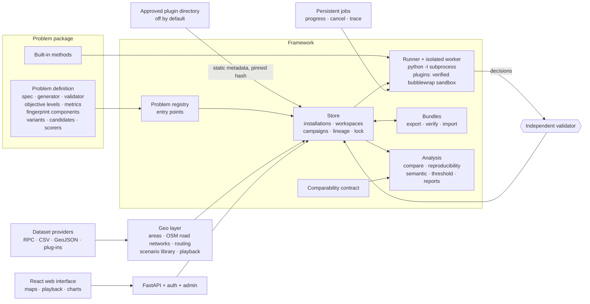
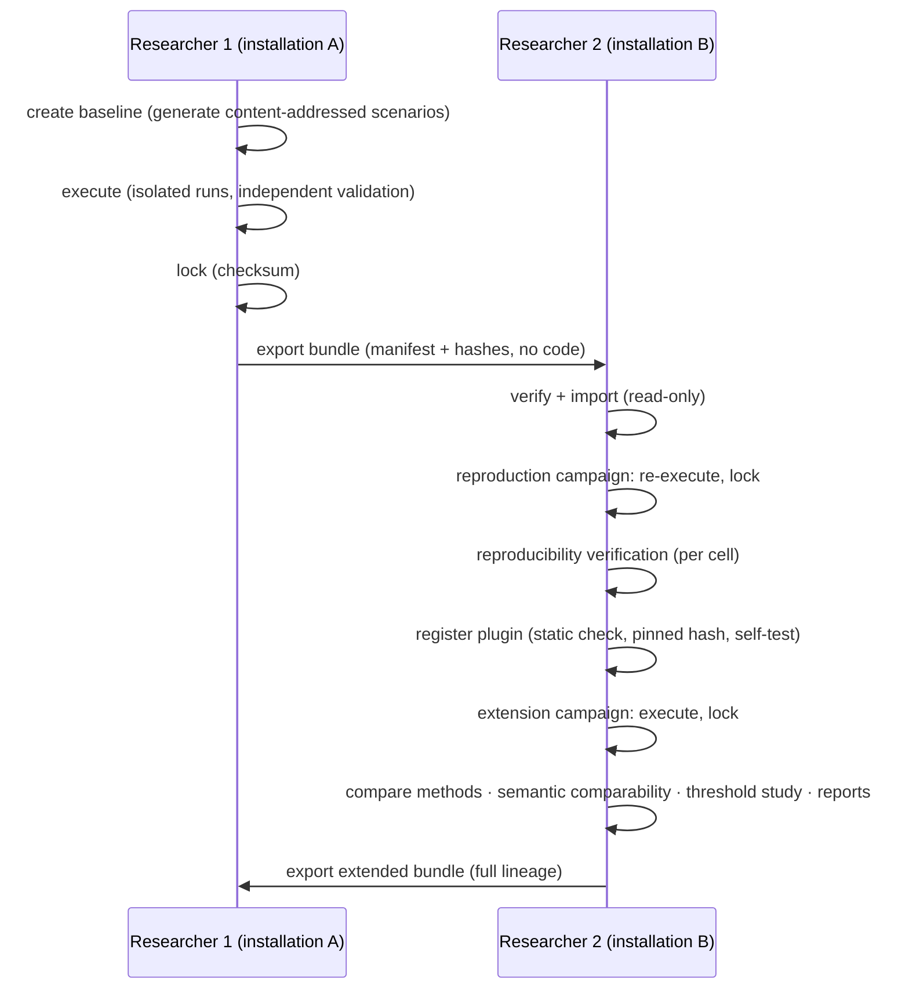
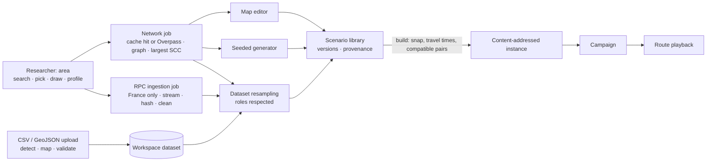
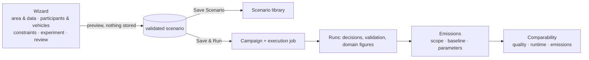

# Architecture

MOVE OpenLab separates a **problem-agnostic framework** from **problem packages**. The framework never knows what a
driver, a route or a cost is; a problem package tells it how to generate, validate, rank and compare.



## Experimentation core and mobility domain

The code base keeps two layers apart. The **experimentation core** knows experiments, methods, isolated execution,
jobs, validators, metrics, comparison, semantic comparability, reproducibility, bundles, provenance, workspaces and
accounts — and never what a vehicle or a tonne of CO₂ is. The **mobility domain** knows areas, road networks,
routing, trip datasets, participants, vehicles, mobility constraints, emissions and mobility metrics, and plugs into
the core through the `Problem` interface (including the optional domain-metric hooks) and the dataset-provider
entry points.

| Layer | Modules |
|---|---|
| Core | `problem`, `registry`, `methods`, `plugins`, `worker`, `runner`, `sandbox`, `store`, `bundles`, `method_tools`, `analysis.*`, `comparability.*`, `scoring`, `jobs`, `limits`, `auth`, `api.experiments`, `api.admin`, `api.lab` (workspace summaries), `api.web`; frontend `lab/` (workspace shell, results, compare, A/B, replay, trace), `components/` |
| Mobility | `geo.*` (areas, OSM networks, routing, scenarios, playback, replay geometry), `datasets.*`, `integrations.rpc`, `mobility.vehicles`, `mobility.emissions` (+ `mobility/presets`), `benchmarks.ride_matching`, `demo`, `api.geo`, `api.areas`, `api.datasets`; frontend `geo/`, `mobility/` (wizard, vehicle editor) |

New domain concepts go under `move_openlab.mobility`; the historical modules stay where they are (no disruptive
move). The core exposes domain figures only through generic hooks: `Problem.domain_metrics` (figures derived from
validated decisions, stored in `run["domain"]`), `domain_descriptor` (what they depend on, compared under their own
claim and carried by bundles), `aggregate_domain` and `domain_metric_definitions`.

## Web interface

The header (`frontend/src/shell`) holds the logo lockup, **Workspace**, a compact **Library** menu (geographic areas,
road networks, mobility data, scenarios, experiments, benchmarks, jobs and traces, hidden records), the jobs indicator,
help (Quick Tour) and the profile menu (My account, My students for a supervising researcher, Administration for
administrators, Appearance light/dark, Change password, Sign out). Light is the default whatever the system setting;
the choice is a per-user preference. Interface strings live in one catalogue (`frontend/src/i18n/en.ts`) so that a
French version can be added without touching the components. The main screen is a map-first **workspace**
(`frontend/src/lab`): a bar with the grouped experiment picker (Public mobility demonstration, My experiments,
Imported, Reproductions, Benchmarks — each with area, data, scenarios, problem, methods and status), the evidence
chips (*Validated n/n*, *Locked*) and Generate, Import, Run, Compare, Export; the experiment with its Area, Road
network, Mobility data (source and sampling stated) and Scenario on the left, the map in the centre (charts for problems without geography), the Method
list with *+ Add method* (built-ins, plugin registration, template and bundle check without leaving the workflow),
live progress (Queued → Preparing → Running methods → Validating → Results, runs done/total, cancel, trace), results
with their measurement basis (one sample or all scenarios, repetitions, aggregation, gap to the exact reference when
meaningful, runtimes in ms below one second), CO₂ of the selected method, and three separate pieces of evidence —
independent validation, reproducibility (only for re-executions) and semantic comparability with *Why?* — on the
right. On first use the demonstration's area is added to the workspace (once; never recreated after removal) and
the baseline opens with a start card (*Compare with the variant*, *Generate your own*, *Try an imported experiment*,
*Quick tour*). *Import → Try an imported experiment* is a guided cycle on the shipped sample bundle (download,
integrity report, import, reproduce, add a method, extend, compare; `GET /api/lab/sample/bundle`, `POST
/api/lab/sample/verify`, `POST /api/lab/sample`). **Export** opens a dialog that lists what the bundle will contain
(`GET /api/lab/export/{id}`: lineage, scenarios, references, methods, vehicle and emission parameters, replay geometry
available) with the required sections fixed and two optional ones — replay geometry (`?geometry=false` leaves it out)
and a separate evidence report (`GET /api/lab/experiments/{id}/evidence`). **Import** is staged: choose a file, inspect
it on the server (`POST /api/lab/inspect`: complete verification, nothing written; new / identical / conflicting
records, methods available here, warnings), see what it contains, then confirm — or, when the records are already
present, *Reproduce it here*. The comparison workspace's evidence summary can be collapsed to a one-line strip (the
choice is remembered on the browser) and states claim by claim what is identical, comparable, or not applicable. The
map has an expanded mode (header and side panels give way, the action bar stays, panels open as overlays, Esc exits).
Help holds the Quick Tour (shown only on request; *Don't show again* is kept per account) and short definitions of
Area, Mobility data, Scenario, Library and Hidden records. In the Library, *Use* applies a record to the Workspace: an
area becomes the working area (preference `area_id`, validated), mobility data opens Generate with that data, a scenario
starts a new experiment with it.
Areas, datasets, scenarios and experiments can be hidden from every list (a per-user preference; nothing is deleted)
and shown again with *Show hidden*. **Generate** opens a five-step wizard
over the map (`frontend/src/mobility/Wizard.tsx`): Area & Data (choose an area, search a place, pick a point or draw
a box, resize it, choose the road-network profile, then *Create area and prepare road network*; mobility data
sampled from observed trips, synthetic, or placed on the map), Participants & Vehicles (generated or placed on the
map with a route preview; ICE, HEV, PHEV, BEV or custom profiles), Constraints, Methods & Experiment (methods with
*+ Add method*, repetitions, seed, CO₂ calculation and baseline), Review & Save — nothing is stored before *Save
Scenario* or *Save & Run* (`POST /api/lab/run`: scenario, experiment and execution in one call). *Run* on an existing experiment
executes a draft, or derives from a locked experiment: a re-execution with the same methods, an extension when
methods were added. **Compare** opens the table and charts of one experiment; *Compare with…* lists the candidates (`GET
/api/lab/compatible?a=`): every executed experiment of the same problem with its relation to A (reproduction,
controlled variant, extension, same scenario, same problem in another file, different scenario) and the verdicts of
the semantic engine, directly and conditionally comparable ones first, incompatible ones under *Show incompatible (n)*
with their reasons; verdicts are cached per pair of record checksums. *Compare selected* opens the **comparison
workspace** (`#/compare/<A>|<B1>,<B2>…`, `GET /api/lab/diff`): two maps with synchronised view (A and the selected B),
one replay clock, compatible metrics of every B in one table, and the differences between the two solutions. Secondary sections hold the data tools (areas, datasets, scenario
library, the same wizard — advanced management views, not a second Generate workflow), the full experiment records
and reports, jobs with their execution timeline, the students of a supervising researcher, and administration. Every
view has a URL (`#/workspace/<id>`, `#/compare/<A>|<B…>`, `#/data/<view>`, `#/experiments/<view>`, `#/jobs`,
`#/students`, `#/admin`). The header carries the MOVE OpenLab logo; the footer shows *Development build* until the
first official release (`display_version()`).

## Package layout

| Module | Role |
|---|---|
| `move_openlab.problem` | `Problem` interface, metric and objective-level definitions, variants |
| `move_openlab.registry` | Problem discovery (`move_openlab.problems` entry points); no import-path manipulation |
| `move_openlab.methods` | Method metadata and output contract, registry, read-only views |
| `move_openlab.plugins` | Approved plugin directory: static metadata, path confinement, code hashes |
| `move_openlab.worker`, `runner` | Isolated execution, timing, independent validation of every run |
| `move_openlab.sandbox` | Plugin modes, bubblewrap sandbox, isolation verification (fail closed), server hardening |
| `move_openlab.store` | Installations, per-user workspaces, campaigns, derivations, lock |
| `move_openlab.bundles` | Bundle export, complete verification and import (formats 1 and 2), experiment and semantic fingerprints |
| `move_openlab.demo` | The shipped demonstration bundle, imported once per workspace (with the demonstration's area) |
| `move_openlab.samples` | The shipped sample bundle (kept unpacked, packed deterministically on demand), offered only when its recorded cross-installation check passed |
| `move_openlab.custom_metrics` | Custom metrics (`move_openlab.metrics` entry points): contract check, per-problem registry, evaluation from validated figures only, aggregation |
| `move_openlab.method_tools` | `method new` (template) and `method check` (metadata, sandboxed self-test, run on a bundle) |
| `move_openlab.analysis` | Comparison, reproducibility, semantic comparability, threshold studies, reports |
| `move_openlab.comparability` | Fingerprints and the claim-dependent comparability contract |
| `move_openlab.scoring` | Scorer interface, threshold / top-k selection |
| `move_openlab.jobs` | Persistent background jobs: progress, events, cancellation, restart recovery, history |
| `move_openlab.geo` | Road-network profiles, Overpass fetch and graph build, content-addressed store (`osm`), routing and coverage (`network`), workspace areas (`areas`), place-search proxy (`geocode`), scenarios and generators, route playback, replay geometry carried by bundles (`geometry`) |
| `move_openlab.datasets` | Trip normalisation and validation (`tabular`), CSV and GeoJSON readers, provider registry (`move_openlab.dataset_providers` entry points), workspace dataset store |
| `move_openlab.integrations` | Public data connectors: `rpc` (RPC carpooling open-data releases, France) |
| `move_openlab.mobility` | `vehicles` (profiles, documented parameter records, versioned presets with sources, per-workspace store), `emissions` (scopes, baselines, formulas, descriptor and fingerprint, aggregation) |
| `move_openlab.limits` | Daily quotas and one-at-a-time locks for external services; bounded upload parsing |
| `move_openlab.auth`, `api` | Accounts (versioned SQLite schema) and sessions; HTTP API routers `experiments`, `geo`, `areas`, `datasets`, `admin`, `lab` (workspace preferences, demonstration, experiment summaries); request-size limits; single-origin web application |
| `move_openlab.benchmarks.synthetic_assignment` | Synthetic capacitated assignment problem (methodological tests; the separate synthetic scientific benchmark is planned) |
| `move_openlab.benchmarks.ride_matching` | Ride matching on road networks (exact MILP, greedy, variants, relative-detour scorer) |

## Experimentation pipeline



### Geographic scenarios



Building an instance snaps every origin and destination to the network, computes the travel times and distances
needed by the problem and the emission model, freezes each driver's vehicle profile (and the default vehicle used
for riders in the baseline) and stores all of it in the instance. Everything downstream (methods, validation,
emissions, bundles, reproduction) works from the instance alone; the network is only needed again to draw road
geometry in the playback. Vehicle and emission data are non-binding for the optimization problem: they change the
instance hash (another experiment) but not the problem fingerprint (same feasible region and objective).



### Jobs

Executions, network downloads and open-data ingestions run as background jobs; downloads wait for their turn so
that each external service receives one request at a time. A job records its owner, kind, subject,
state (`running`, `done`, `error`, `cancelled`, `interrupted`), progress and timestamped events, persisted as JSON so
the history survives restarts; jobs that were running when the server stopped are marked `interrupted`, and campaigns
left mid-execution return to draft. Cancelling stops the worker process group; runs completed before the
cancellation are discarded so a campaign is never partially executed. An execution reports the stages `prepare`,
`run` (one event per method run), `validate` (how many solutions the independent validator accepted) and `complete`,
which the interface shows as Queued → Preparing → Running methods → Validating → Results. Every run carries a per-stage trace (prepare,
execute, validate, domain when domain figures exist); the web interface turns the event log into an execution
timeline (created, queued, preparing, every method run with its stage durations, persistence, completion,
cancellation, errors) with the raw events under *Technical details*.

## Data model

```
<data>/installation.json
<data>/instances/<sha256>.json                 immutable, content-addressed
<data>/workspaces/<user>/campaigns/<id>/campaign.json
<data>/workspaces/<user>/campaigns/<id>/import_record.json
<data>/workspaces/<user>/methods.json          registered plugins (id, version, code hash, self-test)
<data>/workspaces/<user>/scenarios/<id>.json    scenario library entry (scenario, provenance, parent, instance hash)
<data>/workspaces/<user>/areas/<id>.json        named area: box, profile, attached network id
<data>/workspaces/<user>/datasets/<key>/        uploaded dataset: normalised trips + validation report (no raw file)
<data>/workspaces/<user>/preferences.json       workspace preferences (tour, last experiment, area, hidden records) and demo record
<data>/workspaces/<user>/vehicles.json          the researcher's vehicle profiles (versioned; never deleted by the application)
<data>/workspaces/<user>/geometry/<hash>.json   replay geometry imported with bundles (per workspace)
<data>/networks/<network_id>/                   road network, provenance, compressed raw Overpass response
<data>/opendata/rpc/<dataset_key>/              cleaned RPC trips (no identifiers) and ingestion report
<data>/cache/geocode/                           cached place-search results
<data>/jobs/<user>/<job_id>.json                job state, progress and events
<data>/audit.log                                administrative actions (no secrets)
```

A campaign records: specification (problem, objective, constraints, instance schema, validator and framework
versions), scenario set (parameters, generator, instance hashes), methods (with code hashes for plugins),
configuration (repetitions, timeout, time budget, per-method options, emission scope and baseline), runs (decisions,
validation, declared values, timings, effective configuration, domain figures such as emissions), environment,
parent link (id, checksum, relation) and checksum. A ride-matching instance additionally carries, per driver, the
frozen vehicle profile and, per agent and pair, the road distances the emission model needs.

## Comparison semantics

Rankings follow the problem's lexicographic objective levels. A method that is worse on an earlier level is never
ranked better because of a later level. Gaps are computed on the last level only where every previous level equals
the reference. Runtime comparisons across installations or environments are reported as indicative.

Each run also states its optimality scope: *proven optimal (full problem)* for an exact method that proved optimality
on the original instance; *optimal for the reduced instance only* when the instance was pruned by a threshold; *not
proven (time limit)*; *feasible, optimality not proven*; *heuristic (no optimality claim)*; *invalid (rejected by the
validator)*. "Equals reference optimum" in a comparison counts scenarios where a method reached the reference's
objective values; it is not a proof of optimality.

Semantic comparability decides, per claim, whether two results are directly comparable, conditionally comparable or
incompatible: a different feasible region, objective or metric definition makes a quality claim incompatible; a
non-binding change (different file, same problem fingerprint) does not; a different time budget, method option or
environment qualifies the claim. Positive scaling of a metric is the only built-in verified normalisation. The
emissions claim has its own rules (scope, baseline, units or missing data → incompatible; other parameter values or
vehicle assignments → conditional) and never affects the quality or runtime verdicts; scenarios of two experiments
are matched by instance hash, by derivation, or by equal problem fingerprint.
