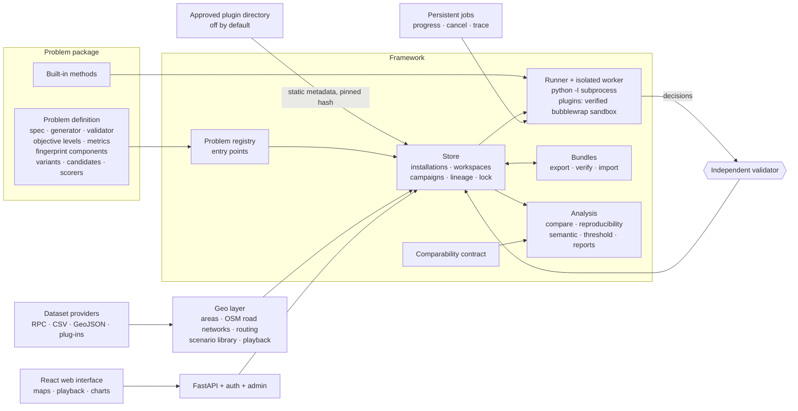
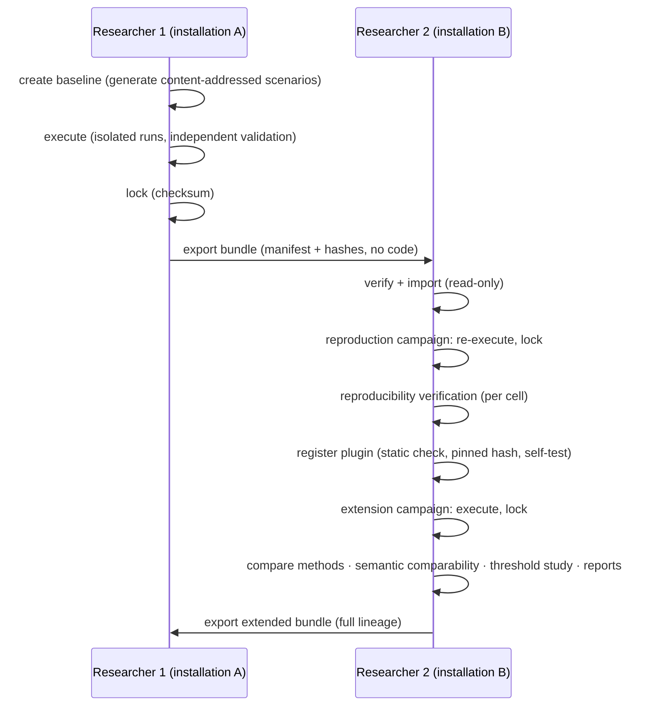
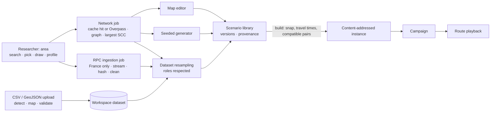

# Architecture

MOVE OpenLab separates a **problem-agnostic framework** from **problem packages**. The framework never knows what a
driver, a route or a cost is; a problem package tells it how to generate, validate, rank and compare.



## Web interface

The main screen is a map-first **workspace** (`frontend/src/lab`): a top bar (Area, Dataset, Experiment; Generate,
Run, Compare, Replay, Import, Export, Quick Tour), the experiment and its participants on the left, the map in the
centre (charts for problems without geography), methods, live progress, results and comparability on the right.
*Run* creates and executes a new experiment, executes a draft, or derives from a locked experiment: a re-execution
with the same methods, an extension when methods were added. Secondary sections hold the data tools (areas,
datasets, scenario library, editor, generators), the full experiment records and reports, jobs and administration.
Every view has a URL (`#/workspace/<id>`, `#/data/<view>`, `#/experiments/<view>`, `#/jobs`, `#/admin`).

## Package layout

| Module | Role |
|---|---|
| `move_openlab.problem` | `Problem` interface, metric and objective-level definitions, variants |
| `move_openlab.registry` | Problem discovery (`move_openlab.problems` entry points); no import-path manipulation |
| `move_openlab.methods` | Method metadata and output contract, registry, read-only views |
| `move_openlab.plugins` | Approved plugin directory: static metadata, path confinement, code hashes |
| `move_openlab.worker`, `runner` | Isolated execution, timing, independent validation of every run |
| `move_openlab.sandbox` | Plugin modes, bubblewrap sandbox, isolation verification (fail closed), server hardening |
| `move_openlab.store` | Installations, per-user workspaces, campaigns, derivations, lock |
| `move_openlab.bundles` | Bundle export, complete verification and import (formats 1 and 2), experiment and semantic fingerprints |
| `move_openlab.demo` | The shipped demonstration bundle, imported once per workspace |
| `move_openlab.method_tools` | `method new` (template) and `method check` (metadata, sandboxed self-test, run on a bundle) |
| `move_openlab.analysis` | Comparison, reproducibility, semantic comparability, threshold studies, reports |
| `move_openlab.comparability` | Fingerprints and the claim-dependent comparability contract |
| `move_openlab.scoring` | Scorer interface, threshold / top-k selection |
| `move_openlab.jobs` | Persistent background jobs: progress, events, cancellation, restart recovery, history |
| `move_openlab.geo` | Road-network profiles, Overpass fetch and graph build, content-addressed store (`osm`), routing and coverage (`network`), workspace areas (`areas`), place-search proxy (`geocode`), scenarios and generators, route playback, replay geometry carried by bundles (`geometry`) |
| `move_openlab.datasets` | Trip normalisation and validation (`tabular`), CSV and GeoJSON readers, provider registry (`move_openlab.dataset_providers` entry points), workspace dataset store |
| `move_openlab.integrations` | Public data connectors: `rpc` (RPC carpooling open-data releases, France) |
| `move_openlab.limits` | Daily quotas and one-at-a-time locks for external services; bounded upload parsing |
| `move_openlab.auth`, `api` | Accounts (versioned SQLite schema) and sessions; HTTP API routers `experiments`, `geo`, `areas`, `datasets`, `admin`, `lab` (workspace preferences, demonstration, experiment summaries); request-size limits; single-origin web application |
| `move_openlab.benchmarks.synthetic_assignment` | Synthetic capacitated assignment benchmark |
| `move_openlab.benchmarks.ride_matching` | Ride matching on road networks (exact MILP, greedy, variants, relative-detour scorer) |

## Experimentation pipeline



### Geographic scenarios



Building an instance snaps every origin and destination to the network, computes the travel times needed by the
problem and stores them in the instance. Everything downstream (methods, validation, bundles, reproduction) works from
the instance alone; the network is only needed again to draw road geometry in the playback.

### Jobs

Executions, network downloads and open-data ingestions run as background jobs; downloads wait for their turn so
that each external service receives one request at a time. A job records its owner, kind, subject,
state (`running`, `done`, `error`, `cancelled`, `interrupted`), progress and timestamped events, persisted as JSON so
the history survives restarts; jobs that were running when the server stopped are marked `interrupted`, and campaigns
left mid-execution return to draft. Cancelling stops the worker process group; runs completed before the
cancellation are discarded so a campaign is never partially executed. Every run carries a per-stage trace (prepare,
execute, validate) used for the stage-duration table and the replay in the web interface.

## Data model

```
<data>/installation.json
<data>/instances/<sha256>.json                 immutable, content-addressed
<data>/workspaces/<user>/campaigns/<id>/campaign.json
<data>/workspaces/<user>/campaigns/<id>/import_record.json
<data>/workspaces/<user>/methods.json          registered plugins (id, version, code hash, self-test)
<data>/workspaces/<user>/scenarios/<id>.json    scenario library entry (scenario, provenance, parent, instance hash)
<data>/workspaces/<user>/areas/<id>.json        named area: box, profile, attached network id
<data>/workspaces/<user>/datasets/<key>/        uploaded dataset: normalised trips + validation report (no raw file)
<data>/workspaces/<user>/preferences.json       workspace preferences (tour, last experiment, area) and demo record
<data>/geometry/<instance_hash>.json            replay geometry imported with bundles
<data>/networks/<network_id>/                   road network, provenance, compressed raw Overpass response
<data>/opendata/rpc/<dataset_key>/              cleaned RPC trips (no identifiers) and ingestion report
<data>/cache/geocode/                           cached place-search results
<data>/jobs/<user>/<job_id>.json                job state, progress and events
<data>/audit.log                                administrative actions (no secrets)
```

A campaign records: specification (problem, objective, constraints, instance schema, validator and framework
versions), scenario set (parameters, generator, instance hashes), methods (with code hashes for plugins),
configuration (repetitions, timeout, time budget, per-method options), runs (decisions, validation, declared values,
timings, effective configuration), environment, parent link (id, checksum, relation) and checksum.

## Comparison semantics

Rankings follow the problem's lexicographic objective levels. A method that is worse on an earlier level is never
ranked better because of a later level. Gaps are computed on the last level only where every previous level equals
the reference. Runtime comparisons across installations or environments are reported as indicative.

Each run also states its optimality scope: *proven optimal (full problem)* for an exact method that proved optimality
on the original instance; *optimal for the reduced instance only* when the instance was pruned by a threshold; *not
proven (time limit)*; *feasible, optimality not proven*; *heuristic (no optimality claim)*; *invalid (rejected by the
validator)*. "Equals reference optimum" in a comparison counts scenarios where a method reached the reference's
objective values; it is not a proof of optimality.

Semantic comparability decides, per claim, whether two results are directly comparable, conditionally comparable or
incompatible: a different feasible region, objective or metric definition makes a quality claim incompatible; a
non-binding change (different file, same problem fingerprint) does not; a different time budget, method option or
environment qualifies the claim. Positive scaling of a metric is the only built-in verified normalisation.
