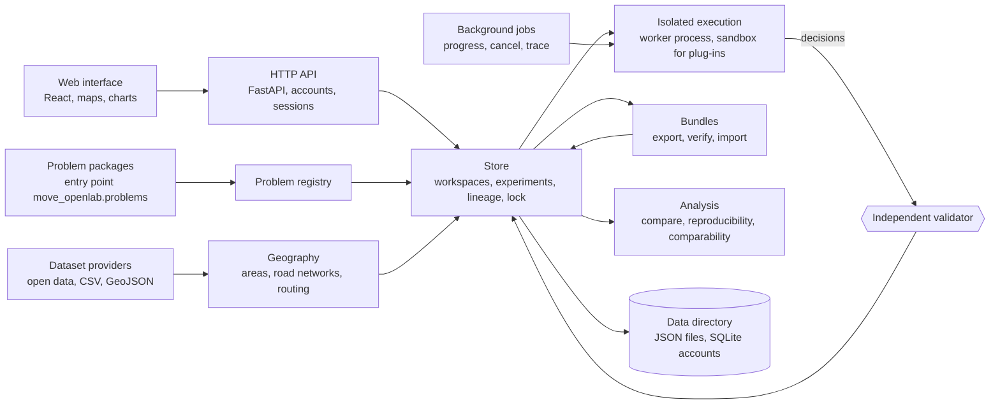
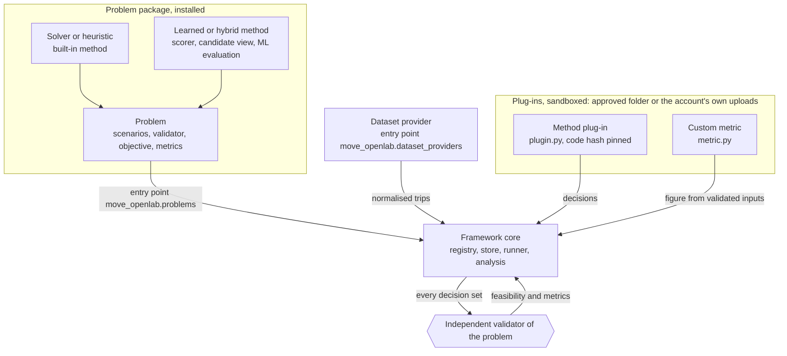
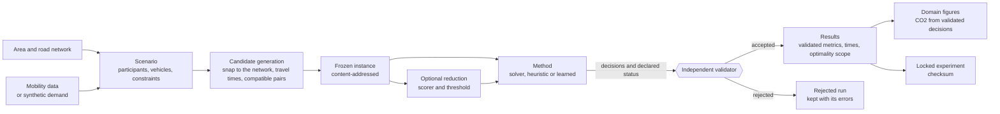
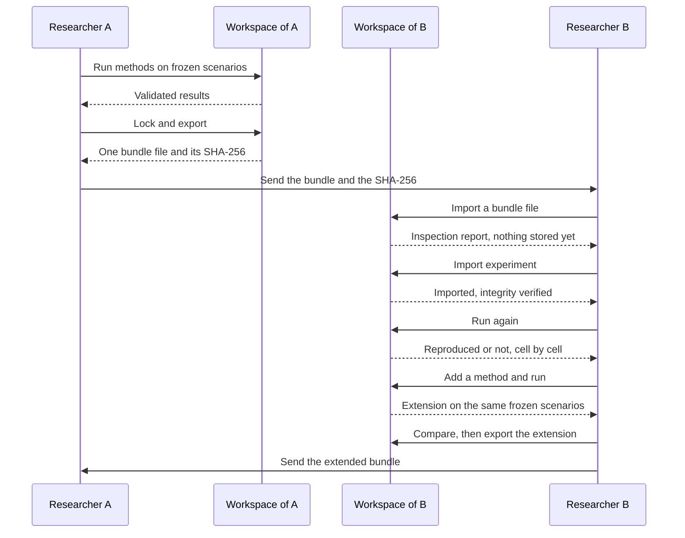
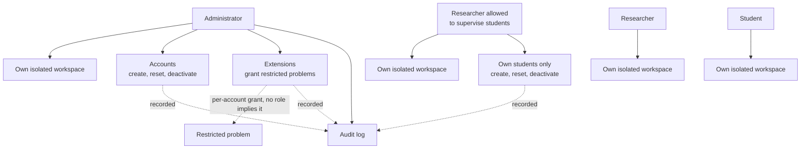
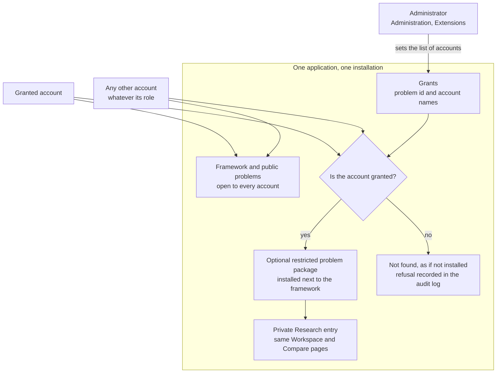
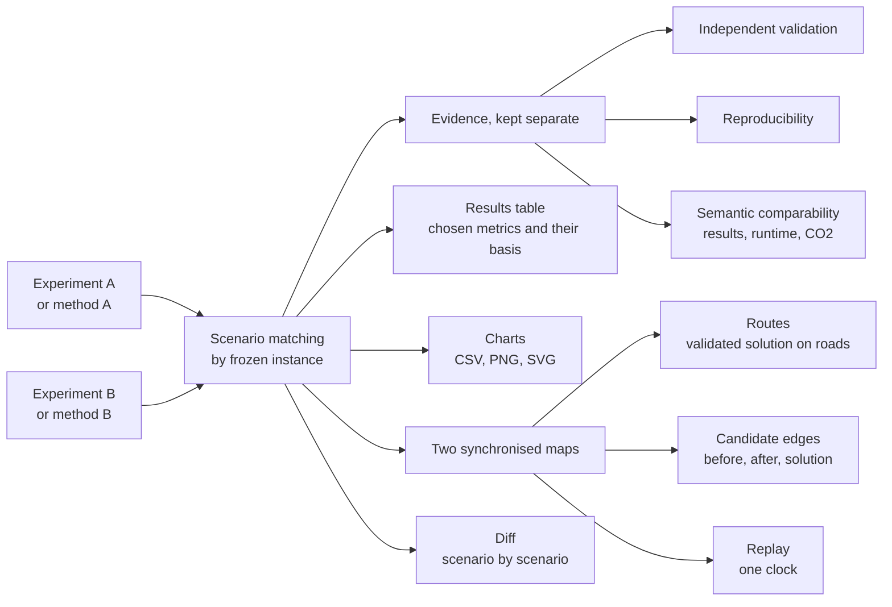
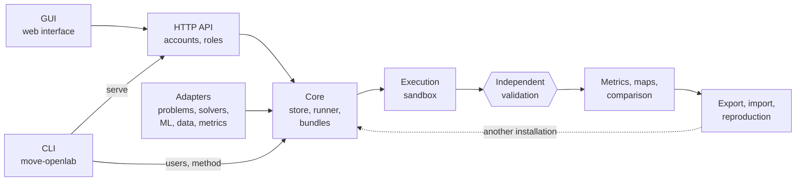

# Diagrams

Eight diagrams of the framework. Each is embedded below as a Mermaid block, which GitHub renders, and kept as a source file
under [`docs/diagrams/`](diagrams/) for reuse in slides or papers. Every name in them is generic or belongs to the public
demonstrations.

| # | Diagram | Source |
|---|---|---|
| 1 | [Generic architecture](#1-generic-architecture) | [`diagrams/01-architecture.mmd`](diagrams/01-architecture.mmd) |
| 2 | [Adapters](#2-adapters) | [`diagrams/02-adapters.mmd`](diagrams/02-adapters.mmd) |
| 3 | [From scenario to results](#3-from-scenario-to-results) | [`diagrams/03-pipeline.mmd`](diagrams/03-pipeline.mmd) |
| 4 | [Export, import and reproduction between two researchers](#4-export-import-and-reproduction-between-two-researchers) | [`diagrams/04-exchange.mmd`](diagrams/04-exchange.mmd) |
| 5 | [Roles and authorization](#5-roles-and-authorization) | [`diagrams/05-roles.mmd`](diagrams/05-roles.mmd) |
| 6 | [Optional restricted problem package in one application](#6-optional-restricted-problem-package-in-one-application) | [`diagrams/06-restricted-package.mmd`](diagrams/06-restricted-package.mmd) |
| 7 | [Scientific comparison and map visualization](#7-scientific-comparison-and-map-visualization) | [`diagrams/07-comparison.mmd`](diagrams/07-comparison.mmd) |
| 8 | [GUI and CLI](#8-gui-and-cli) | [`diagrams/08-gui-cli.mmd`](diagrams/08-gui-cli.mmd) |

## 1. Generic architecture

The interface talks to one HTTP API; the store keeps workspaces, experiments and their lineage as files; methods run in isolated
processes and every result passes through the problem's independent validator before it is stored. Problem packages,
dataset providers and the geography layer plug into the core, which never interprets what a driver or a route is.
Details: [ARCHITECTURE.md](ARCHITECTURE.md).

## 2. Adapters

A problem package brings the problem, its reference solvers and, when it has them, learned methods; method plug-ins and
custom metrics are third-party files that run only in the sandbox; a dataset provider turns a file format or a service into
normalised trips. Whatever produced the decisions, the problem's validator recomputes feasibility and every metric.
Details: [ADAPTERS.md](ADAPTERS.md).

## 3. From scenario to results

A scenario is built into a frozen, content-addressed instance that already contains its candidates (for ride matching: the
compatible pairs with their travel times). A method — optionally after a reduction of the candidates — returns decisions;
the validator accepts or rejects them, and only accepted runs get results and domain figures. Rejected runs are kept.
Details: [SOLVER_INTEGRATION.md](SOLVER_INTEGRATION.md), [ML_INTEGRATION.md](ML_INTEGRATION.md).

## 4. Export, import and reproduction between two researchers

Researcher A locks and exports one bundle; researcher B inspects it before anything is stored, imports it, re-executes it,
adds a method and sends the extension back. The two workspaces may be on one installation or on two: the path is the same.
Details: [MULTI_USER.md](MULTI_USER.md#export--import--reproduce-between-two-researchers), [REPRODUCIBILITY.md](REPRODUCIBILITY.md).

## 5. Roles and authorization

Every account has its own isolated workspace; roles decide who manages accounts. An administrator manages accounts,
extensions and reads the audit log; a researcher allowed to supervise manages their own students only. Access to a
restricted problem is a per-account grant that no role implies.
Details: [MULTI_USER.md](MULTI_USER.md), [SECURITY_MODEL.md](SECURITY_MODEL.md).

## 6. Optional restricted problem package in one application

There is one application. A restricted problem package is installed next to the framework and granted to named accounts;
a granted account reaches it through the ordinary pages and gets a *Private Research* entry. For every other account the
server answers as if the package were not installed, and an installation without such a package has nothing to show.
Details: [PRIVATE_EXTENSIONS.md](PRIVATE_EXTENSIONS.md).

## 7. Scientific comparison and map visualization

Two experiments, or two methods of one experiment, are matched scenario by scenario on their frozen instances. Validation,
reproducibility and semantic comparability stay three separate statements; the same matched data feeds the results table,
the charts, two synchronised maps (routes, candidate edges, replay) and the scenario-by-scenario diff.
Details: [METRICS.md](METRICS.md), [MAPS.md](MAPS.md).

## 8. GUI and CLI

The browser interface and the `move-openlab` command reach the same core. The GUI goes through the HTTP API with the
account's session; `move-openlab serve` starts that API and the interface, `users` manages accounts in the credential store,
and `method new` / `method check` generate a method template and check it — metadata, sandboxed self-test and, with an
experiment bundle, a validated run on its instances. Every result of either route passes the problem's independent validator.

## Editing a diagram

Edit the `.mmd` source and copy it into the block above; the two must stay identical. Keep the syntax plain — `flowchart`
or `sequenceDiagram`, quoted labels, ` ` for line breaks — so that GitHub renders it. Use public or synthetic names only.
